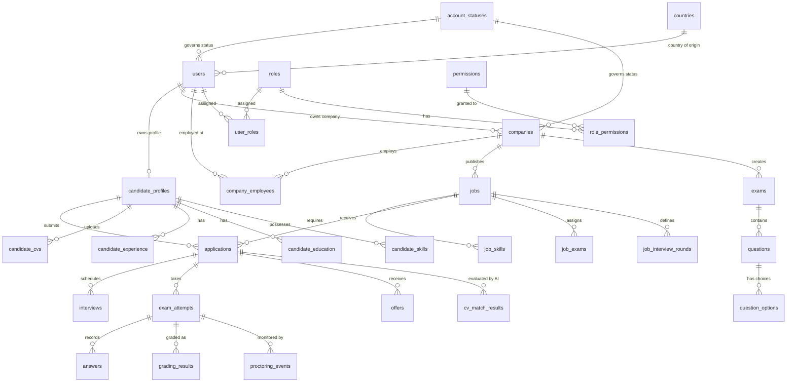

# Database Documentation — HR Management & Recruitment System

## 1. Overview & Architecture

This database schema powers an enterprise-grade **HR Management & AI-driven Recruitment Platform** built on **Laravel 12** and **MySQL / MariaDB**. It connects Job Candidates, Employers (Companies), HR Managers, Interviewers, and Platform Administrators in a unified talent acquisition and evaluation lifecycle.

### Key Highlights
* **Total Tables:** 55 tables (45 application entity tables, 3 pivot tables, and Laravel internal support tables).
* **Audit Trail Standards:** Every application table features automated user tracking (`UID` / `LUID`), timestamps (`created_at` / `updated_at`), and soft deletion (`deleted_at`).
* **Relational Integrity:** 172 Foreign Key constraints enforce referential integrity with cascading updates and safe nullifications on delete.
* **Granular RBAC:** Role-Based Access Control supporting both platform-level and company-scoped roles.

---

## 2. Global Conventions & Standards

### 2.1 Audit & Tracking Columns
Every business entity table in this database implements the following columns:

| Column | Type | Nullable | Description |
| :--- | :--- | :--- | :--- |
| `id` | `BIGINT UNSIGNED` | No | Auto-increment primary key. |
| `UID` | `BIGINT UNSIGNED` | Yes | **User ID (Created By)** — The user ID who created the record. Foreign key to `users.id`. |
| `LUID` | `BIGINT UNSIGNED` | Yes | **Last User ID (Updated By)** — The user ID who last modified the record. Foreign key to `users.id`. |
| `created_at` | `TIMESTAMP` | Yes | Timestamp when the record was initially created. |
| `updated_at` | `TIMESTAMP` | Yes | Timestamp when the record was last modified. |
| `deleted_at` | `TIMESTAMP` | Yes | Timestamp for soft deletion. Records are preserved in the DB for recovery and auditing. |

> **Automated Trait:** In Eloquent models, the `App\Traits\Auditable` trait automatically injects `Auth::id()` into `UID` and `LUID` during model creation and updates.

### 2.2 Account Status Architecture
Rather than hardcoding status strings, accounts are governed by a normalized lookup table: `account_statuses`.

* **1 — Active:** Fully operational account.
* **2 — Deactivated:** Temporarily disabled by the user or administrator.
* **3 — Blocked:** Restricted due to policy violations.
* **4 — Deleted:** User requested account deletion (coupled with `softDeletes` for grace-period recovery).

Both individual candidate accounts and employer accounts (in `users` and `companies`) reference `account_status_id`.

---

## 3. Entity Relationship Overview



---

## 4. Module Breakdown & Table Dictionary

### 4.1 Authentication, Access Control & Accounts
* **`account_statuses`**: Normalized master lookup for account lifecycle states (`Active`, `Deactivated`, `Blocked`, `Deleted`).
* **`users`**: Central account table for all platform users. `account_type` distinguishes `candidate`, `company`, or `admin`.
* **`roles`**: Defines platform and company-level roles (e.g., Superadmin, HR Manager, Interviewer).
* **`permissions`**: Granular platform permissions (e.g., `job.create`, `applicant.evaluate`).
* **`role_permissions`**: Pivot table mapping permissions to roles.
* **`user_roles`**: Many-to-many relationship assigning roles to users, optionally scoped to a `company_id`.

### 4.2 Company Management
* **`companies`**: Organization profile, verification documents, approval status (`pending`, `approved`, `rejected`, `suspended`), and owner reference.
* **`company_employees`**: Links registered users to companies with specific job titles, departments, and employment statuses.
* **`company_social_links`**: Social media and external links for companies.

### 4.3 Candidate Profiles & Resumes
* **`candidate_profiles`**: Comprehensive talent profiles containing headline, summary, location, total years of experience, current salary, and expected salary.
* **`candidate_cvs`**: Uploaded resume files (PDF, DOCX) and parsed text.
* **`candidate_experience`**: Detailed work history records (company name, title, dates, descriptions).
* **`candidate_education`**: Degree, institution, field of study, and graduation dates.
* **`candidate_courses`**: Certifications, training programs, and completion dates.
* **`skills`**: Master skills dictionary (e.g., PHP, Laravel, Python, Machine Learning).
* **`candidate_skills`**: Pivot table associating candidates with skills and proficiency levels.
* **`candidate_social_links`**: Portfolio, GitHub, and LinkedIn links for candidates.

### 4.4 Job Postings & Nominations
* **`job_categories`**: Functional industries/categories (e.g., Engineering, Marketing, Finance).
* **`jobs`**: Job postings with salary ranges, experience required, employment type (`full-time`, `part-time`, `remote`, `hybrid`), and lifecycle status (`draft`, `published`, `closed`).
* **`job_skills`**: Skills required for specific jobs with `is_required` flags.
* **`job_nominations`**: Headhunting and internal referrals of candidates for open requisitions.

### 4.5 Application Pipeline & Offers
* **`applications`**: Applications submitted by candidates for jobs, tracking stages from `applied` to `screening`, `interview`, `offered`, `hired`, or `rejected`.
* **`application_status_history`**: Complete audit trail log of every status change and reviewer remarks.
* **`offers`**: Formal job offers detailing proposed salary, start dates, expiration dates, and acceptance/rejection status.

### 4.6 Interviews & Scheduling
* **`job_interview_rounds`**: Stage configurations per job (e.g., Round 1: HR Screening, Round 2: Technical, Round 3: Culture Fit).
* **`interviews`**: Scheduled interview sessions linking candidate, round, and meeting links.
* **`interviewer_availability`**: Date and time availability slots defined by interviewers.
* **`interview_bookings`**: Calendar slot reservations for candidates.
* **`interview_evaluations`**: Scorecards, criteria ratings, and recommendation notes submitted by interviewers.
* **`calendar_integrations`**: OAuth tokens and sync settings for Google Calendar / Outlook.

### 4.7 Examination, Proctoring & Automated Grading
* **`exams`**: Online technical/cognitive assessments with duration and passing score settings.
* **`job_exams`**: Associates exams with jobs at specific hiring stages.
* **`questions`**: Question bank supporting multiple choice, text, and coding challenges.
* **`question_options`**: Options and correct flags for multiple-choice questions.
* **`question_test_cases`**: Automated unit test cases and expected outputs for coding challenges.
* **`exam_attempts`**: Individual exam sessions initiated by candidates.
* **`answers`**: Candidate responses submitted per question.
* **`grading_results`**: Automated and manual scores with pass/fail outcomes.
* **`proctoring_events`**: Anti-cheating monitoring logs (tab switching, face detection alerts, multiple monitors).
* **`proctoring_reviews`**: Human auditor review of proctoring flags and cheating determinations.

### 4.8 AI & Smart Decision Support
* **`cv_match_results`**: AI-generated semantic matching scores between candidate resumes and job descriptions.
* **`ai_review_decisions`**: AI recommendations (shortlist, review, reject) with reasoning and feature weights.
* **`salary_records`**: Anonymized market benchmark salary data points.
* **`salary_recommendations`**: Suggested competitive compensation ranges based on candidate experience and market standards.

### 4.9 Communication & Localization
* **`notifications`**: In-app notifications with read status and payload links.
* **`chatbot_sessions`**: Conversational AI assistant sessions with candidates and employers.
* **`chatbot_messages`**: Message history within chatbot sessions.
* **`countries`**: Master country list with ISO country codes and international dial phone codes.

### 4.10 Laravel Framework Technical Tables
* **`password_reset_tokens`**: Secure password reset tokens.
* **`sessions`**: Database-backed user sessions.
* **`queue_jobs`**: Background worker queue jobs (custom-named to avoid collision with job postings).
* **`job_batches`**: Batched job processing tracking.
* **`failed_jobs`**: Failed background job exceptions and payloads.
* **`personal_access_tokens`**: Laravel Sanctum API authentication tokens.

---

## 5. Eloquent Models & Trait Integration

All 45 business models reside in `app/Models/` and extend `Illuminate\Database\Eloquent\Model`.

```php
use App\Traits\Auditable;
use Illuminate\Database\Eloquent\SoftDeletes;

class Job extends Model
{
    use SoftDeletes, Auditable;

    protected $guarded = [];
}
```

### Automatic Model Auditing
When an authenticated user saves or updates a model:
```php
$job = Job::create([...]);
// $job->UID is automatically set to Auth::id()
// $job->LUID is automatically set to Auth::id()

$job->update([...]);
// $job->LUID is automatically updated to Auth::id()
```

### Accessing Audit Relations
```php
$creator = $job->creator; // Returns User model of author
$updater = $job->updater; // Returns User model of last editor
```

---

## 6. Database Setup & Migration Instructions

### Prerequisites
* PHP 8.2+
* MySQL 8.0+ or MariaDB 10.5+
* Database created: `recruitment_platform` (Collation: `utf8mb4_unicode_ci`)

### Run Migrations
From the project root:
```bash
# Clean database build and seed default lookup data:
php artisan migrate:fresh

# Verify all migrations ran successfully:
php artisan migrate:status
```

