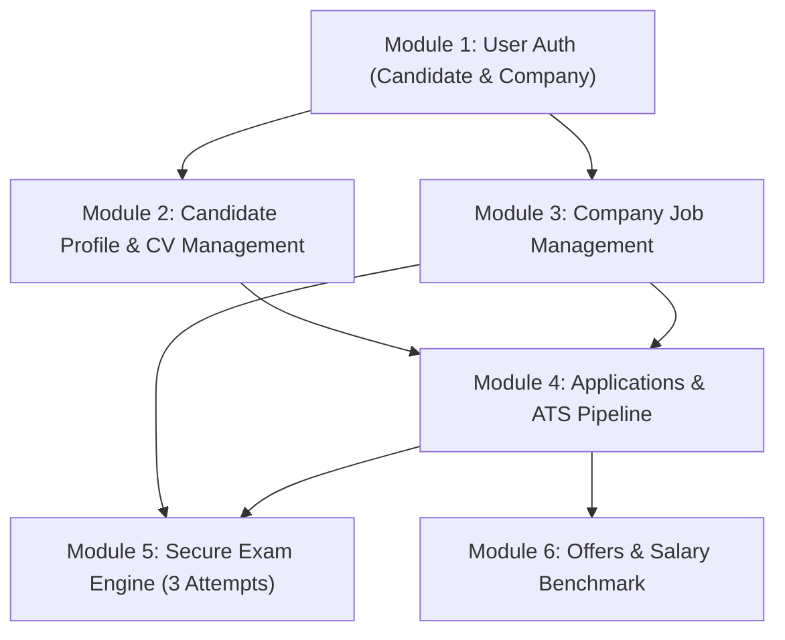

# HR Management & AI Recruitment System: Full Backend Architecture, API & Database Audit

---

## 1. Executive Summary & System Overview

This comprehensive technical report provides an exhaustive audit of the **HR Management & Recruitment Platform (Laravel 12 Backend)**. It covers:
1. **The Database Catalog:** Complete specification of the final physical tables across the system, including the isolated platform-admin tables and their audit trail attributes.
2. **Current Implementation:** The current route inventory contains **147 API route entries** and **120 OpenAPI paths**. Part B account/authentication tests pass; a full SQLite run currently has **236 passing tests and 11 known legacy fixture failures** unrelated to Part B. Admin authentication uses the dedicated `admins` table.
3. **Interactive Documentation & Contracts:** OpenAPI documentation generated automatically via `dedoc/scramble` at `/docs/api` and exported to `api.json` for frontend consumption and automated TypeScript type generation.

---

## 2. Complete Database Catalog (All 55 Tables)

Every table below is created by Laravel migrations. The complete migration-and-seeding flow is verified by the setup feature test with SQLite; run the same commands against MySQL for local development. Application tables include audit columns (`UID`, `LUID`, `created_at`, `updated_at`, `deleted_at`).

| # | Table Name | Migration File | Primary Purpose / Role | Audit Trail Support |
|---|------------|----------------|------------------------|---------------------|
| 1 | `audit_logs` | [2026_10_23_000003_create_audit_logs_table.php](file:///c:/Projects/hr_managment_system/database/migrations/2026_10_23_000003_create_audit_logs_table.php) | Administrative and security audit events | `timestamps` |
| 2 | `account_statuses` | [2026_10_20_100000_create_account_statuses_table.php](file:///c:/Projects/hr_managment_system/database/migrations/2026_10_20_100000_create_account_statuses_table.php) | Lookup table for status (Active=1, Deactivated=2, Blocked=3, Deleted=4) | Full (`UID`, `LUID`, SoftDeletes) |
| 3 | `users` | [2026_10_20_100001_create_users_table.php](file:///c:/Projects/hr_managment_system/database/migrations/2026_10_20_100001_create_users_table.php) | Core user identities (Candidates, HR, Interviewers, Employees) | Full (`UID`, `LUID`, SoftDeletes) |
| 4 | `password_reset_tokens` | [2026_10_20_100002_create_laravel_support_tables.php](file:///c:/Projects/hr_managment_system/database/migrations/2026_10_20_100002_create_laravel_support_tables.php) | Laravel framework password reset tokens | Framework Internal |
| 5 | `sessions` | [2026_10_20_100002_create_laravel_support_tables.php](file:///c:/Projects/hr_managment_system/database/migrations/2026_10_20_100002_create_laravel_support_tables.php) | HTTP session storage for web sessions | Framework Internal |
| 6 | `queue_jobs` | [2026_10_20_100002_create_laravel_support_tables.php](file:///c:/Projects/hr_managment_system/database/migrations/2026_10_20_100002_create_laravel_support_tables.php) | Background queue jobs (renamed from `jobs` to avoid conflict) | Framework Internal |
| 7 | `job_batches` | [2026_10_20_100002_create_laravel_support_tables.php](file:///c:/Projects/hr_managment_system/database/migrations/2026_10_20_100002_create_laravel_support_tables.php) | Batch execution tracking for queues | Framework Internal |
| 8 | `failed_jobs` | [2026_10_20_100002_create_laravel_support_tables.php](file:///c:/Projects/hr_managment_system/database/migrations/2026_10_20_100002_create_laravel_support_tables.php) | Failed background queue records | Framework Internal |
| 9 | `roles` | [2026_10_20_100003_create_roles_table.php](file:///c:/Projects/hr_managment_system/database/migrations/2026_10_20_100003_create_roles_table.php) | User RBAC roles (candidate, company_admin, hr, interviewer, employee) | Full (`UID`, `LUID`, SoftDeletes) |
| 10 | `permissions` | [2026_10_20_100004_create_permissions_table.php](file:///c:/Projects/hr_managment_system/database/migrations/2026_10_20_100004_create_permissions_table.php) | Granular permission keys (`jobs.create`, `cvs.view`, etc.) | Full (`UID`, `LUID`, SoftDeletes) |
| 11 | `role_permissions` | [2026_10_20_100005_create_role_permissions_table.php](file:///c:/Projects/hr_managment_system/database/migrations/2026_10_20_100005_create_role_permissions_table.php) | Pivot table mapping roles to permissions | Pivot (`UID`, `LUID`, Timestamps) |
| 12 | `companies` | [2026_10_20_100006_create_companies_table.php](file:///c:/Projects/hr_managment_system/database/migrations/2026_10_20_100006_create_companies_table.php) | Company profiles, verification documents, and account status | Full (`UID`, `LUID`, SoftDeletes) |
| 13 | `user_roles` | [2026_10_20_100007_create_user_roles_table.php](file:///c:/Projects/hr_managment_system/database/migrations/2026_10_20_100007_create_user_roles_table.php) | Pivot table mapping users to roles within companies | Pivot (`UID`, `LUID`, Timestamps) |

Platform administrators are isolated from the user RBAC tables. Their account, roles, permissions, and assignments live in `admins`, `admin_roles`, `admin_permissions`, `admin_role_permissions`, and `admin_role_assignments`, created by [2026_10_27_000001_create_platform_admin_auth_tables.php](file:///c:/Projects/hr_managment_system/database/migrations/2026_10_27_000001_create_platform_admin_auth_tables.php). The cleanup migrations remove old MFA columns and the legacy user `super_admin` role.
| 14 | `company_social_links` | [2026_10_20_100008_create_company_social_links_table.php](file:///c:/Projects/hr_managment_system/database/migrations/2026_10_20_100008_create_company_social_links_table.php) | Social links (LinkedIn, Twitter, Website) for companies | Full (`UID`, `LUID`, SoftDeletes) |
| 15 | `company_employees` | [2026_10_20_100009_create_company_employees_table.php](file:///c:/Projects/hr_managment_system/database/migrations/2026_10_20_100009_create_company_employees_table.php) | Employee records, titles, and approval statuses | Full (`UID`, `LUID`, SoftDeletes) |
| 16 | `candidate_profiles` | [2026_10_20_100010_create_candidate_profiles_table.php](file:///c:/Projects/hr_managment_system/database/migrations/2026_10_20_100010_create_candidate_profiles_table.php) | Candidate bio, headline, photo, years of experience | Full (`UID`, `LUID`, SoftDeletes) |
| 17 | `candidate_experience` | [2026_10_20_100011_create_candidate_experience_table.php](file:///c:/Projects/hr_managment_system/database/migrations/2026_10_20_100011_create_candidate_experience_table.php) | Candidate work history (company, title, start/end dates) | Full (`UID`, `LUID`, SoftDeletes) |
| 18 | `skills` | [2026_10_20_100012_create_skills_table.php](file:///c:/Projects/hr_managment_system/database/migrations/2026_10_20_100012_create_skills_table.php) | Master skill lookup list (PHP, Laravel, Docker, etc.) | Full (`UID`, `LUID`, SoftDeletes) |
| 19 | `candidate_skills` | [2026_10_20_100013_create_candidate_skills_table.php](file:///c:/Projects/hr_managment_system/database/migrations/2026_10_20_100013_create_candidate_skills_table.php) | Pivot table mapping candidate profiles to skills | Pivot (`UID`, `LUID`, Timestamps) |
| 20 | `candidate_cvs` | [2026_10_20_100014_create_candidate_cvs_table.php](file:///c:/Projects/hr_managment_system/database/migrations/2026_10_20_100014_create_candidate_cvs_table.php) | Uploaded CV files (PDF/DOCX), versions, storage paths | Full (`UID`, `LUID`, SoftDeletes) |
| 21 | `candidate_education` | [2026_10_20_100015_create_candidate_education_table.php](file:///c:/Projects/hr_managment_system/database/migrations/2026_10_20_100015_create_candidate_education_table.php) | Degree, institution, field of study, graduation year | Full (`UID`, `LUID`, SoftDeletes) |
| 22 | `candidate_courses` | [2026_10_20_100016_create_candidate_courses_table.php](file:///c:/Projects/hr_managment_system/database/migrations/2026_10_20_100016_create_candidate_courses_table.php) | Certifications, courses, and issuing organizations | Full (`UID`, `LUID`, SoftDeletes) |
| 23 | `candidate_social_links` | [2026_10_20_100017_create_candidate_social_links_table.php](file:///c:/Projects/hr_managment_system/database/migrations/2026_10_20_100017_create_candidate_social_links_table.php) | GitHub, Portfolio, LinkedIn URLs for candidate | Full (`UID`, `LUID`, SoftDeletes) |
| 24 | `job_categories` | [2026_10_20_100018_create_job_categories_table.php](file:///c:/Projects/hr_managment_system/database/migrations/2026_10_20_100018_create_job_categories_table.php) | Job taxonomy categories (Engineering, Marketing, etc.) | Full (`UID`, `LUID`, SoftDeletes) |
| 25 | `jobs` | [2026_10_20_100019_create_jobs_table.php](file:///c:/Projects/hr_managment_system/database/migrations/2026_10_20_100019_create_jobs_table.php) | Job postings, requirements, salaries, visibility | Full (`UID`, `LUID`, SoftDeletes) |
| 26 | `job_skills` | [2026_10_20_100020_create_job_skills_table.php](file:///c:/Projects/hr_managment_system/database/migrations/2026_10_20_100020_create_job_skills_table.php) | Pivot table mapping required skills to job postings | Pivot (`UID`, `LUID`, Timestamps) |
| 27 | `job_nominations` | [2026_10_20_100021_create_job_nominations_table.php](file:///c:/Projects/hr_managment_system/database/migrations/2026_10_20_100021_create_job_nominations_table.php) | Internal employee nominations for private jobs | Full (`UID`, `LUID`, SoftDeletes) |
| 28 | `job_interview_rounds` | [2026_10_20_100022_create_job_interview_rounds_table.php](file:///c:/Projects/hr_managment_system/database/migrations/2026_10_20_100022_create_job_interview_rounds_table.php) | Interview round definitions per job (Technical, HR, etc.) | Full (`UID`, `LUID`, SoftDeletes) |
| 29 | `applications` | [2026_10_20_100023_create_applications_table.php](file:///c:/Projects/hr_managment_system/database/migrations/2026_10_20_100023_create_applications_table.php) | Candidate job applications, CV link, cover note, attempt | Full (`UID`, `LUID`, SoftDeletes) |
| 30 | `application_status_history` | [2026_10_20_100024_create_application_status_history_table.php](file:///c:/Projects/hr_managment_system/database/migrations/2026_10_20_100024_create_application_status_history_table.php) | Stage transition audit log for candidate application | Full (`UID`, `LUID`, SoftDeletes) |
| 31 | `offers` | [2026_10_20_100025_create_offers_table.php](file:///c:/Projects/hr_managment_system/database/migrations/2026_10_20_100025_create_offers_table.php) | Formal job offers, salary, terms, acceptance state | Full (`UID`, `LUID`, SoftDeletes) |
| 32 | `interviews` | [2026_10_20_100026_create_interviews_table.php](file:///c:/Projects/hr_managment_system/database/migrations/2026_10_20_100026_create_interviews_table.php) | Interview sessions, type (online/onsite), meeting link, notes | Full (`UID`, `LUID`, SoftDeletes) |
| 33 | `interviewer_availability` | [2026_10_20_100027_create_interviewer_availability_table.php](file:///c:/Projects/hr_managment_system/database/migrations/2026_10_20_100027_create_interviewer_availability_table.php) | Open time windows set by interviewers for booking | Full (`UID`, `LUID`, SoftDeletes) |
| 34 | `interview_bookings` | [2026_10_20_100028_create_interview_bookings_table.php](file:///c:/Projects/hr_managment_system/database/migrations/2026_10_20_100028_create_interview_bookings_table.php) | Confirmed appointments linking interview, slot & interviewer | Full (`UID`, `LUID`, SoftDeletes) |
| 35 | `interview_evaluations` | [2026_10_20_100029_create_interview_evaluations_table.php](file:///c:/Projects/hr_managment_system/database/migrations/2026_10_20_100029_create_interview_evaluations_table.php) | Numerical score (0-100), internal notes, candidate feedback | Full (`UID`, `LUID`, SoftDeletes) |
| 36 | `calendar_integrations` | [2026_10_20_100030_create_calendar_integrations_table.php](file:///c:/Projects/hr_managment_system/database/migrations/2026_10_20_100030_create_calendar_integrations_table.php) | Google/Outlook OAuth calendar sync credentials | Full (`UID`, `LUID`, SoftDeletes) |
| 37 | `exams` | [2026_10_20_100031_create_exams_table.php](file:///c:/Projects/hr_managment_system/database/migrations/2026_10_20_100031_create_exams_table.php) | Technical exam metadata, duration, passing score | Full (`UID`, `LUID`, SoftDeletes) |
| 38 | `job_exams` | [2026_10_20_100032_create_job_exams_table.php](file:///c:/Projects/hr_managment_system/database/migrations/2026_10_20_100032_create_job_exams_table.php) | Mapping between jobs and required exams | Full (`UID`, `LUID`, SoftDeletes) |
| 39 | `questions` | [2026_10_20_100033_create_questions_table.php](file:///c:/Projects/hr_managment_system/database/migrations/2026_10_20_100033_create_questions_table.php) | Question text, type (MCQ, code, text), points | Full (`UID`, `LUID`, SoftDeletes) |
| 40 | `question_options` | [2026_10_20_100034_create_question_options_table.php](file:///c:/Projects/hr_managment_system/database/migrations/2026_10_20_100034_create_question_options_table.php) | Multiple choice options and `is_correct` flags | Full (`UID`, `LUID`, SoftDeletes) |
| 41 | `question_test_cases` | [2026_10_20_100035_create_question_test_cases_table.php](file:///c:/Projects/hr_managment_system/database/migrations/2026_10_20_100035_create_question_test_cases_table.php) | Input/output test cases for coding challenges | Full (`UID`, `LUID`, SoftDeletes) |
| 42 | `exam_attempts` | [2026_10_20_100036_create_exam_attempts_table.php](file:///c:/Projects/hr_managment_system/database/migrations/2026_10_20_100036_create_exam_attempts_table.php) | Candidate exam sessions (tracks attempt 1, 2, 3) | Full (`UID`, `LUID`, SoftDeletes) |
| 43 | `answers` | [2026_10_20_100037_create_answers_table.php](file:///c:/Projects/hr_managment_system/database/migrations/2026_10_20_100037_create_answers_table.php) | Candidate answers submitted for each question | Full (`UID`, `LUID`, SoftDeletes) |
| 44 | `grading_results` | [2026_10_20_100038_create_grading_results_table.php](file:///c:/Projects/hr_managment_system/database/migrations/2026_10_20_100038_create_grading_results_table.php) | Auto-grading score & breakdown per exam attempt | Full (`UID`, `LUID`, SoftDeletes) |
| 45 | `proctoring_events` | [2026_10_20_100039_create_proctoring_events_table.php](file:///c:/Projects/hr_managment_system/database/migrations/2026_10_20_100039_create_proctoring_events_table.php) | Browser tab switches, webcam face detection events | Full (`UID`, `LUID`, SoftDeletes) |
| 46 | `proctoring_reviews` | [2026_10_20_100040_create_proctoring_reviews_table.php](file:///c:/Projects/hr_managment_system/database/migrations/2026_10_20_100040_create_proctoring_reviews_table.php) | Human/AI final proctoring verdict (Pass, Suspicious, Fail) | Full (`UID`, `LUID`, SoftDeletes) |
| 47 | `cv_match_results` | [2026_10_20_100041_create_cv_match_results_table.php](file:///c:/Projects/hr_managment_system/database/migrations/2026_10_20_100041_create_cv_match_results_table.php) | AI semantic match score (0-100) between CV and Job | Full (`UID`, `LUID`, SoftDeletes) |
| 48 | `ai_review_decisions` | [2026_10_20_100042_create_ai_review_decisions_table.php](file:///c:/Projects/hr_managment_system/database/migrations/2026_10_20_100042_create_ai_review_decisions_table.php) | AI recommendation & HR human override logs | Full (`UID`, `LUID`, SoftDeletes) |
| 49 | `salary_records` | [2026_10_20_100043_create_salary_records_table.php](file:///c:/Projects/hr_managment_system/database/migrations/2026_10_20_100043_create_salary_records_table.php) | Anonymized market compensation benchmark data | Full (`UID`, `LUID`, SoftDeletes) |
| 50 | `salary_recommendations` | [2026_10_20_100044_create_salary_recommendations_table.php](file:///c:/Projects/hr_managment_system/database/migrations/2026_10_20_100044_create_salary_recommendations_table.php) | Algorithmic salary suggestion based on interview & test | Full (`UID`, `LUID`, SoftDeletes) |
| 51 | `notifications` | [2026_10_20_100045_create_notifications_table.php](file:///c:/Projects/hr_managment_system/database/migrations/2026_10_20_100045_create_notifications_table.php) | In-app user notifications with read tracking | Full (`UID`, `LUID`, SoftDeletes) |
| 52 | `chatbot_sessions` | [2026_10_20_100046_create_chatbot_sessions_table.php](file:///c:/Projects/hr_managment_system/database/migrations/2026_10_20_100046_create_chatbot_sessions_table.php) | Conversation sessions with AI Chatbot | Full (`UID`, `LUID`, SoftDeletes) |
| 53 | `chatbot_messages` | [2026_10_20_100047_create_chatbot_messages_table.php](file:///c:/Projects/hr_managment_system/database/migrations/2026_10_20_100047_create_chatbot_messages_table.php) | Messages exchanged in chatbot conversation | Full (`UID`, `LUID`, SoftDeletes) |
| 54 | `countries` | [2026_10_20_100048_create_countries_table.php](file:///c:/Projects/hr_managment_system/database/migrations/2026_10_20_100048_create_countries_table.php) | ISO country codes and localized names | Full (`UID`, `LUID`, SoftDeletes) |
| 55 | `personal_access_tokens` | [2026_10_21_062735_create_personal_access_tokens_table.php](file:///c:/Projects/hr_managment_system/database/migrations/2026_10_21_062735_create_personal_access_tokens_table.php) | Laravel Sanctum API authentication tokens | Framework Token Store |
| 56 | `email_verification_codes` | [2026_10_29_000001_create_email_verification_codes_table.php](file:///c:/Projects/hr_managment_system/database/migrations/2026_10_29_000001_create_email_verification_codes_table.php) | Hashed, expiring one-time email verification codes | User-owned, consumed timestamp |

---

## 3. Currently Implemented APIs & Components

The module inventory below documents the main API flows. The source of truth is [`routes/api.php`](file:///c:/Projects/hr_managment_system/routes/api.php), which currently contains 147 API route entries and is backed by targeted feature tests.

### 3.1. Public Job Discovery Module
- **Controller:** [`App\Http\Controllers\Api\JobController`](file:///c:/Projects/hr_managment_system/app/Http/Controllers/Api/JobController.php)
- **Request:** [`App\Http\Requests\JobIndexRequest`](file:///c:/Projects/hr_managment_system/app/Http/Requests/JobIndexRequest.php)
- **Resources:** [`App\Http\Resources\JobResource`](file:///c:/Projects/hr_managment_system/app/Http/Resources/JobResource.php), [`App\Http\Resources\JobDetailResource`](file:///c:/Projects/hr_managment_system/app/Http/Resources/JobDetailResource.php)

| HTTP Method | Route Endpoint | Action / Method | Middleware | Description |
|:---|:---|:---|:---|:---|
| `GET` | `/api/jobs` | `JobController@index` | `throttle:60,1` | Browse available jobs with keyword search, title search, company search, skill filtering, salary sorting, and pagination. |
| `GET` | `/api/jobs/{job}` | `JobController@show` | `throttle:60,1` | Retrieve single published job details including company, category, and required skills. |

### 3.2. Admin Authentication Module
- **Controllers:** [`App\Http\Controllers\Api\Admin\AdminAuthController`](file:///c:/Projects/hr_managment_system/app/Http/Controllers/Api/Admin/AdminAuthController.php), [`App\Http\Controllers\Api\Admin\AdminAnalyticsController`](file:///c:/Projects/hr_managment_system/app/Http/Controllers/Api/Admin/AdminAnalyticsController.php)
- **Model:** [`App\Models\Admin`](file:///c:/Projects/hr_managment_system/app/Models/Admin.php)
- **Middleware:** [`App\Http\Middleware\EnsureAdmin`](file:///c:/Projects/hr_managment_system/app/Http/Middleware/EnsureAdmin.php)

| HTTP Method | Route Endpoint | Action / Method | Middleware | Description |
|:---|:---|:---|:---|:---|
| `POST` | `/api/admin/login` | `AdminAuthController@login` | None | Authenticate a platform admin via email and password; returns Sanctum bearer token. No MFA/OTP is required. |
| `POST` | `/api/admin/forgot-password` | `AdminAuthController@forgotPassword` | None | Send admin password reset notification with token. |
| `POST` | `/api/admin/reset-password` | `AdminAuthController@resetPassword` | None | Reset admin password using verification token. |
| `POST` | `/api/admin/logout` | `AdminAuthController@logout` | `auth:sanctum`, `admin` | Revoke current admin Sanctum bearer token. |
| `GET` | `/api/admin/me` | `AdminAuthController@me` | `auth:sanctum`, `admin` | Return authenticated admin profile and isolated admin permissions. |
| `GET` | `/api/admin/analytics` | `AdminAnalyticsController@index` | `auth:sanctum`, `admin`, `super-admin`, `reports.view` | Detailed platform analytics available to Super Admin only: breakdowns, trends, recruitment funnel, conversion rates, top companies/jobs, pending actions, and audit activity. |

### 3.3. Candidate Interview Module
- **Controllers:** [`App\Http\Controllers\Api\CandidateInterviewController`](file:///c:/Projects/hr_managment_system/app/Http/Controllers/Api/CandidateInterviewController.php), [`App\Http\Controllers\Api\CandidateAvailableSlotsController`](file:///c:/Projects/hr_managment_system/app/Http/Controllers/Api/CandidateAvailableSlotsController.php)
- **Requests:** [`CandidateBookInterviewRequest`](file:///c:/Projects/hr_managment_system/app/Http/Requests/CandidateBookInterviewRequest.php), [`CandidateInterviewFilterRequest`](file:///c:/Projects/hr_managment_system/app/Http/Requests/CandidateInterviewFilterRequest.php), [`RescheduleInterviewRequest`](file:///c:/Projects/hr_managment_system/app/Http/Requests/RescheduleInterviewRequest.php), [`CancelInterviewRequest`](file:///c:/Projects/hr_managment_system/app/Http/Requests/CancelInterviewRequest.php)
- **Resource:** [`CandidateInterviewResource`](file:///c:/Projects/hr_managment_system/app/Http/Resources/CandidateInterviewResource.php)

| HTTP Method | Route Endpoint | Action / Method | Middleware | Description |
|:---|:---|:---|:---|:---|
| `GET` | `/api/candidate/available-slots` | `CandidateAvailableSlotsController@index` | `auth:sanctum` | List eligible open interviewer availability slots for candidate's application. |
| `GET` | `/api/candidate/interviews` | `CandidateInterviewController@index` | `auth:sanctum` | List candidate's scheduled, upcoming, and past interviews with timeline. |
| `POST` | `/api/candidate/interviews/book` | `CandidateInterviewController@book` | `auth:sanctum` | Book an open availability slot; locks slot and creates interview booking. |
| `GET` | `/api/candidate/interviews/{id}` | `CandidateInterviewController@show` | `auth:sanctum` | View interview details, instructions, meeting link, and published feedback (IDOR protected). |
| `POST` | `/api/candidate/interviews/{id}/reschedule` | `CandidateInterviewController@reschedule` | `auth:sanctum` | Reschedule interview slot (enforces 24-hour advance window). |
| `POST` | `/api/candidate/interviews/{id}/cancel` | `CandidateInterviewController@cancel` | `auth:sanctum` | Cancel booked interview (enforces 24-hour advance window). |

### 3.4. Interviewer & Availability Management Module
- **Controllers:** [`App\Http\Controllers\Api\InterviewerAvailabilityController`](file:///c:/Projects/hr_managment_system/app/Http/Controllers/Api/InterviewerAvailabilityController.php), [`App\Http\Controllers\Api\InterviewerInterviewController`](file:///c:/Projects/hr_managment_system/app/Http/Controllers/Api/InterviewerInterviewController.php)
- **Requests:** [`StoreAvailabilityRequest`](file:///c:/Projects/hr_managment_system/app/Http/Requests/StoreAvailabilityRequest.php), [`UpdateAvailabilityRequest`](file:///c:/Projects/hr_managment_system/app/Http/Requests/UpdateAvailabilityRequest.php)
- **Resources:** [`InterviewerAvailabilityResource`](file:///c:/Projects/hr_managment_system/app/Http/Resources/InterviewerAvailabilityResource.php), [`InterviewerInterviewResource`](file:///c:/Projects/hr_managment_system/app/Http/Resources/InterviewerInterviewResource.php)
- **Policy:** [`InterviewerAvailabilityPolicy`](file:///c:/Projects/hr_managment_system/app/Policies/InterviewerAvailabilityPolicy.php)

| HTTP Method | Route Endpoint | Action / Method | Middleware | Description |
|:---|:---|:---|:---|:---|
| `GET` | `/api/interviewer/interviews` | `InterviewerInterviewController@index` | `auth:sanctum` | List interviews assigned to the authenticated interviewer. |
| `GET` | `/api/interviewer/interviews/{id}` | `InterviewerInterviewController@show` | `auth:sanctum` | View assigned interview details, candidate info, and CV. |
| `GET` | `/api/interviewer/availabilities` | `InterviewerAvailabilityController@index` | `auth:sanctum` | List availability slots created by the interviewer. |
| `POST` | `/api/interviewer/availabilities` | `InterviewerAvailabilityController@store` | `auth:sanctum` | Create new open availability slot (validates overlap and future times). |
| `GET` | `/api/interviewer/availabilities/{id}` | `InterviewerAvailabilityController@show` | `auth:sanctum` | View single availability slot. |
| `PUT/PATCH` | `/api/interviewer/availabilities/{id}` | `InterviewerAvailabilityController@update` | `auth:sanctum` | Update slot timing (disallowed if slot is already booked). |
| `DELETE` | `/api/interviewer/availabilities/{id}` | `InterviewerAvailabilityController@destroy` | `auth:sanctum` | Delete unbooked availability slot permanently. |

### 3.5. Interview Scheduling & Evaluation Lifecycle
- **Controllers:** [`App\Http\Controllers\Api\InterviewSchedulingController`](file:///c:/Projects/hr_managment_system/app/Http/Controllers/Api/InterviewSchedulingController.php), [`App\Http\Controllers\Api\InterviewEvaluationController`](file:///c:/Projects/hr_managment_system/app/Http/Controllers/Api/InterviewEvaluationController.php)
- **Requests:** [`ScheduleInterviewRequest`](file:///c:/Projects/hr_managment_system/app/Http/Requests/ScheduleInterviewRequest.php), [`SubmitEvaluationRequest`](file:///c:/Projects/hr_managment_system/app/Http/Requests/SubmitEvaluationRequest.php)
- **Resource:** [`InterviewEvaluationResource`](file:///c:/Projects/hr_managment_system/app/Http/Resources/InterviewEvaluationResource.php)
- **Policy:** [`InterviewPolicy`](file:///c:/Projects/hr_managment_system/app/Policies/InterviewPolicy.php)
- **Service:** [`InterviewSchedulingService`](file:///c:/Projects/hr_managment_system/app/Services/InterviewSchedulingService.php)

| HTTP Method | Route Endpoint | Action / Method | Middleware | Description |
|:---|:---|:---|:---|:---|
| `POST` | `/api/interviews` | `InterviewSchedulingController@store` | `auth:sanctum` | HR/Admin schedule new interview round with assigned slots. |
| `POST` | `/api/interviews/{id}/reschedule` | `InterviewSchedulingController@reschedule` | `auth:sanctum` | HR/Admin reschedule an interview. |
| `POST` | `/api/interviews/{id}/cancel` | `InterviewSchedulingController@cancel` | `auth:sanctum` | HR/Admin cancel an interview round. |
| `GET` | `/api/interviews/{id}/evaluations` | `InterviewEvaluationController@index` | `auth:sanctum` | List evaluations for an interview (internal notes hidden from candidates). |
| `POST` | `/api/interviews/{id}/evaluations` | `InterviewEvaluationController@store` | `auth:sanctum` | Assigned interviewer/HR submit score (0-100), internal notes, candidate feedback. |
| `POST` | `/api/interviews/{id}/evaluations/{evaluationId}/publish` | `InterviewEvaluationController@publish` | `auth:sanctum` | Publish candidate feedback to make it visible to the candidate. |

---

## 4. Step-by-Step Implementation Blueprint for Remaining Modules

This section details every file path, controller signature, form request, service, resource, and command required to implement the remaining modules.



---

### 4.1. Module 1: Universal User Authentication (Candidates & Companies)

#### A. Files to Create
1. Controller: `app/Http/Controllers/Api/Auth/UserAuthController.php`
2. Form Requests:
   - `app/Http/Requests/Auth/RegisterCandidateRequest.php`
   - `app/Http/Requests/Auth/RegisterCompanyRequest.php`
   - `app/Http/Requests/Auth/LoginRequest.php`
3. Resource: `app/Http/Resources/UserResource.php`
4. Test: `tests/Feature/Auth/UserAuthTest.php`

#### B. Generation Commands
```bash
php artisan make:controller Api/Auth/UserAuthController
php artisan make:request Auth/RegisterCandidateRequest
php artisan make:request Auth/RegisterCompanyRequest
php artisan make:request Auth/LoginRequest
php artisan make:resource UserResource
php artisan make:test Feature/Auth/UserAuthTest
```

#### C. Controller Class Specification (`UserAuthController.php`)
```php
namespace App\Http\Controllers\Api\Auth;

use App\Http\Controllers\Controller;
use App\Http\Requests\Auth\LoginRequest;
use App\Http\Requests\Auth\RegisterCandidateRequest;
use App\Http\Requests\Auth\RegisterCompanyRequest;
use App\Http\Resources\UserResource;
use App\Models\AccountStatus;
use App\Models\CandidateProfile;
use App\Models\Company;
use App\Models\Role;
use App\Models\User;
use Illuminate\Http\JsonResponse;
use Illuminate\Http\Request;
use Illuminate\Support\Facades\DB;
use Illuminate\Support\Facades\Hash;
use Illuminate\Validation\ValidationException;

class UserAuthController extends Controller
{
    /** POST /api/auth/register/candidate */
    public function registerCandidate(RegisterCandidateRequest $request): JsonResponse;

    /** POST /api/auth/register/company */
    public function registerCompany(RegisterCompanyRequest $request): JsonResponse;

    /** POST /api/auth/login */
    public function login(LoginRequest $request): JsonResponse;

    /** POST /api/auth/logout */
    public function logout(Request $request): JsonResponse;

    /** GET /api/auth/me */
    public function me(Request $request): UserResource;

    /** POST /api/auth/email/verify */
    public function verifyEmail(Request $request): JsonResponse;

    /** POST /api/auth/email/resend */
    public function resendEmailVerification(Request $request): JsonResponse;

    /** PATCH /api/auth/me/preferences */
    public function updatePreferences(Request $request): JsonResponse;
}
```

#### D. Request Validation Rules & Payload Examples
- **`RegisterCandidateRequest`**:
  ```php
  'name'     => ['required', 'string', 'max:255'],
  'email'    => ['required', 'string', 'email', 'max:255', 'unique:users,email'],
  'password' => ['required', 'string', 'min:8', 'confirmed'],
  'phone'    => ['nullable', 'string', 'max:20'],
  ```
- **`RegisterCompanyRequest`**:
  ```php
  'name'          => ['required', 'string', 'max:255'],
  'email'         => ['required', 'string', 'email', 'max:255', 'unique:users,email'],
  'password'      => ['required', 'string', 'min:8', 'confirmed'],
  'company_name'  => ['required', 'string', 'max:255', 'unique:companies,name'],
  'industry'      => ['nullable', 'string', 'max:100'],
  'website'       => ['nullable', 'url', 'max:2048'],
  'contact_email' => ['nullable', 'email', 'max:255'],
  'contact_phone' => ['nullable', 'string', 'max:30'],
  'address'       => ['nullable', 'string', 'max:2000'],
  ```
- **Logic Details:**
  - Candidate registration automatically assigns role `candidate` and creates a linked row in `candidate_profiles` with `account_status_id = 1` (Active).
  - Company registration creates the `users` row, creates the `companies` row with `status='pending'` and `owner_user_id = user.id`, and assigns role `company_admin`.
  - Token creation: `$token = $user->createToken('auth-token', [$user->account_type])->plainTextToken;`.

#### E. Part B account and profile endpoints

| HTTP Method | Route Endpoint | Authentication | Description |
|:---|:---|:---|:---|
| `POST` | `/api/auth/email/verify` | Public | Validates a six-digit code, consumes it once, and sets `users.email_verified_at`. |
| `POST` | `/api/auth/email/resend` | Public | Sends a new code for an unverified account; limited to 3 requests per minute and returns `429` with `retry_after` when exceeded. |
| `PATCH` | `/api/auth/me/preferences` | `auth:sanctum` | Updates `locale` and/or `theme`; theme is `system`, `light`, or `dark`. |
| `POST` | `/api/candidate/profile/photo` | `auth:sanctum` | Stores a JPG/JPEG/PNG/WEBP profile photo up to 5 MB and returns its path and public URL. |
| `DELETE` | `/api/candidate/profile/photo` | `auth:sanctum` | Deletes the stored candidate photo and clears `photo_path`. |

Verification codes are stored hashed in `email_verification_codes`, expire after 10 minutes, and are never returned in an API response. The queued mail uses `EmailVerificationCodeMail`; production needs SMTP settings and a queue worker.

---

### 4.2. Module 2: Candidate Profile, Experience & CV Upload

#### A. Files to Create
1. Controllers:
   - `app/Http/Controllers/Api/Candidate/CandidateProfileController.php`
   - `app/Http/Controllers/Api/Candidate/CandidateCvController.php`
   - `app/Http/Controllers/Api/Candidate/CandidateExperienceController.php`
2. Form Requests:
   - `app/Http/Requests/Candidate/UpdateProfileRequest.php`
   - `app/Http/Requests/Candidate/UploadCvRequest.php`
   - `app/Http/Requests/Candidate/StoreExperienceRequest.php`
3. Resources:
   - `app/Http/Resources/CandidateProfileResource.php`
   - `app/Http/Resources/CandidateCvResource.php`
4. Test: `tests/Feature/Candidate/CandidateProfileTest.php`

#### B. Generation Commands
```bash
php artisan make:controller Api/Candidate/CandidateProfileController
php artisan make:controller Api/Candidate/CandidateCvController
php artisan make:controller Api/Candidate/CandidateExperienceController
php artisan make:request Candidate/UpdateProfileRequest
php artisan make:request Candidate/UploadCvRequest
php artisan make:request Candidate/StoreExperienceRequest
php artisan make:resource CandidateProfileResource
php artisan make:resource CandidateCvResource
php artisan make:test Feature/Candidate/CandidateProfileTest
```

#### C. Controller Class Specification (`CandidateCvController.php`)
```php
namespace App\Http\Controllers\Api\Candidate;

use App\Http\Controllers\Controller;
use App\Http\Requests\Candidate\UploadCvRequest;
use App\Http\Resources\CandidateCvResource;
use App\Models\CandidateCv;
use App\Models\CandidateProfile;
use Illuminate\Http\JsonResponse;
use Illuminate\Http\Request;
use Illuminate\Http\Resources\Json\AnonymousResourceCollection;
use Illuminate\Support\Facades\Storage;

class CandidateCvController extends Controller
{
    /** GET /api/candidate/cvs */
    public function index(Request $request): AnonymousResourceCollection;

    /** POST /api/candidate/cvs (multipart/form-data) */
    public function store(UploadCvRequest $request): CandidateCvResource;

    /** PATCH /api/candidate/cvs/{id}/set-active */
    public function setActive(Request $request, int $id): JsonResponse;

    /** DELETE /api/candidate/cvs/{id} */
    public function destroy(Request $request, int $id): JsonResponse;
}
```

#### D. Implementation Details for CV Upload
- **Validation in `UploadCvRequest`:**
  ```php
  'cv' => ['required', 'file', 'mimes:pdf,docx', 'max:10240'], // Max 10MB
  ```
- **Storage Logic:**
  - Locate candidate profile: `$profile = $request->user()->candidateProfile;`.
  - Calculate next version: `$latestVersion = CandidateCv::where('candidate_id', $profile->id)->max('version') ?? 0;`.
  - Store file: `$path = $request->file('cv')->store("cvs/{$profile->id}", 'local');`.
  - If it's the first CV, automatically set `is_active = true`.

---

### 4.3. Module 3: Job Applications & ATS Pipeline

#### A. Files to Create
1. Controllers:
   - `app/Http/Controllers/Api/Application/CandidateApplicationController.php`
   - `app/Http/Controllers/Api/Application/CompanyApplicationController.php`
2. Service: `app/Services/ApplicationPipelineService.php`
3. Form Requests:
   - `app/Http/Requests/Application/SubmitApplicationRequest.php`
   - `app/Http/Requests/Application/UpdateApplicationStageRequest.php`
4. Resources:
   - `app/Http/Resources/ApplicationResource.php`
   - `app/Http/Resources/ApplicationDetailResource.php`
5. Test: `tests/Feature/Application/ApplicationPipelineTest.php`

#### B. Generation Commands
```bash
php artisan make:controller Api/Application/CandidateApplicationController
php artisan make:controller Api/Application/CompanyApplicationController
php artisan make:request Application/SubmitApplicationRequest
php artisan make:request Application/UpdateApplicationStageRequest
php artisan make:resource ApplicationResource
php artisan make:resource ApplicationDetailResource
php artisan make:test Feature/Application/ApplicationPipelineTest
```

#### C. Service Class Specification (`ApplicationPipelineService.php`)
```php
namespace App\Services;

use App\Models\Application;
use App\Models\ApplicationStatusHistory;
use App\Models\CandidateProfile;
use App\Models\Job;
use Illuminate\Support\Facades\DB;
use Illuminate\Validation\ValidationException;

class ApplicationPipelineService
{
    /**
     * Submit new application for candidate with duplicate check.
     */
    public function submitApplication(int $userId, int $jobId, ?int $cvId, ?string $coverNote): Application
    {
        return DB::transaction(function () use ($userId, $jobId, $cvId, $coverNote) {
            $candidate = CandidateProfile::where('user_id', $userId)->firstOrFail();
            $job = Job::available()->findOrFail($jobId);

            // Attempt calculation
            $existingAttempts = Application::where('job_id', $jobId)
                ->where('candidate_id', $candidate->id)
                ->max('attempt_no') ?? 0;

            $application = Application::create([
                'job_id'       => $job->id,
                'candidate_id' => $candidate->id,
                'cv_id'        => $cvId ?? $candidate->activeCv?->id,
                'cover_note'   => $coverNote,
                'status'       => 'submitted',
                'attempt_no'   => $existingAttempts + 1,
                'applied_at'   => now(),
            ]);

            ApplicationStatusHistory::create([
                'application_id' => $application->id,
                'from_status'    => null,
                'to_status'      => 'submitted',
                'changed_by'     => $userId,
                'comment'        => 'Application submitted by candidate.',
            ]);

            return $application;
        });
    }

    /**
     * Transition application stage and log in history.
     */
    public function transitionStage(Application $application, string $newStage, int $hrUserId, ?string $comment = null): Application
    {
        return DB::transaction(function () use ($application, $newStage, $hrUserId, $comment) {
            $oldStage = $application->status;
            $application->update(['status' => $newStage]);

            ApplicationStatusHistory::create([
                'application_id' => $application->id,
                'from_status'    => $oldStage,
                'to_status'      => $newStage,
                'changed_by'     => $hrUserId,
                'comment'        => $comment,
            ]);

            return $application;
        });
    }
}
```

#### D. Allowed Application Stages
`submitted` → `screening` → `interviewing` → `offered` → `accepted` / `rejected` / `withdrawn`.

---

### 4.4. Module 4: Company Job Creation & Management (Employer Portal)

#### A. Files to Create
1. Controller: `app/Http/Controllers/Api/Company/CompanyJobController.php`
2. Form Requests:
   - `app/Http/Requests/Company/StoreJobRequest.php`
   - `app/Http/Requests/Company/UpdateJobRequest.php`
   - `app/Http/Requests/Company/ChangeJobStatusRequest.php`
3. Resource: `app/Http/Resources/CompanyJobResource.php`
4. Test: `tests/Feature/Company/CompanyJobTest.php`

#### B. Generation Commands
```bash
php artisan make:controller Api/Company/CompanyJobController
php artisan make:request Company/StoreJobRequest
php artisan make:request Company/UpdateJobRequest
php artisan make:request Company/ChangeJobStatusRequest
php artisan make:resource CompanyJobResource
php artisan make:test Feature/Company/CompanyJobTest
```

#### C. Validation in `StoreJobRequest.php`
```php
return [
    'title'              => ['required', 'string', 'max:255'],
    'category_id'        => ['required', 'integer', 'exists:job_categories,id'],
    'description'        => ['required', 'string', 'min:50'],
    'location'           => ['nullable', 'string', 'max:255'],
    'work_mode'          => ['required', Rule::in(['onsite', 'remote', 'hybrid'])],
    'employment_type'    => ['required', 'string'],
    'salary_min'         => ['nullable', 'numeric', 'min:0'],
    'salary_max'         => ['nullable', 'numeric', 'gte:salary_min'],
    'currency'           => ['nullable', 'string', 'size:3'],
    'openings_count'     => ['nullable', 'integer', 'min:1'],
    'deadline'           => ['nullable', 'date', 'after:today'],
    'visibility'         => ['required', Rule::in(['public', 'private'])],
    'skills'             => ['nullable', 'array'],
    'skills.*.id'        => ['required', 'integer', 'exists:skills,id'],
    'skills.*.required'  => ['boolean'],
];
```

---

### 4.5. Module 5: Secure Exam Engine (Timed & Strict 3 Attempts Constraint)

#### A. Files to Create
1. Controllers:
   - `app/Http/Controllers/Api/Exam/CompanyExamController.php`
   - `app/Http/Controllers/Api/Exam/CandidateExamController.php`
2. Service: `app/Services/ExamEngineService.php`
3. Form Requests:
   - `app/Http/Requests/Exam/StoreExamRequest.php`
   - `app/Http/Requests/Exam/SubmitExamAnswerRequest.php`
   - `app/Http/Requests/Exam/RecordProctoringEventRequest.php`
4. Resources:
   - `app/Http/Resources/ExamDetailResource.php`
   - `app/Http/Resources/ExamAttemptResource.php`
5. Test: `tests/Feature/Exam/SecureExamTest.php`

#### B. Generation Commands
```bash
php artisan make:controller Api/Exam/CompanyExamController
php artisan make:controller Api/Exam/CandidateExamController
php artisan make:request Exam/StoreExamRequest
php artisan make:request Exam/SubmitExamAnswerRequest
php artisan make:request Exam/RecordProctoringEventRequest
php artisan make:resource ExamDetailResource
php artisan make:resource ExamAttemptResource
php artisan make:test Feature/Exam/SecureExamTest
```

#### C. Strict 3 Attempts Constraint Logic (`ExamEngineService.php`)
```php
namespace App\Services;

use App\Models\Exam;
use App\Models\ExamAttempt;
use Illuminate\Validation\ValidationException;

class ExamEngineService
{
    public const MAX_ATTEMPTS = 3;

    public function startAttempt(int $examId, int $userId): ExamAttempt
    {
        $exam = Exam::findOrFail($examId);

        // 1. Check existing attempts count
        $attemptCount = ExamAttempt::where('exam_id', $examId)
            ->where('candidate_id', $userId)
            ->count();

        if ($attemptCount >= self::MAX_ATTEMPTS) {
            throw ValidationException::withMessages([
                'exam' => ['Maximum trial attempts (3 attempts) reached for this exam.'],
            ]);
        }

        // 2. Prevent starting if another attempt is still in progress
        $activeAttempt = ExamAttempt::where('exam_id', $examId)
            ->where('candidate_id', $userId)
            ->whereNull('completed_at')
            ->first();

        if ($activeAttempt) {
            return $activeAttempt;
        }

        // 3. Create new attempt
        return ExamAttempt::create([
            'exam_id'      => $exam->id,
            'candidate_id' => $userId,
            'attempt_no'   => $attemptCount + 1,
            'started_at'   => now(),
        ]);
    }
}
```

---

### 4.6. Module 6: Offers & Salary Determination

#### A. Files to Create
1. Controller: `app/Http/Controllers/Api/Offer/OfferController.php`
2. Form Requests:
   - `app/Http/Requests/Offer/CreateOfferRequest.php`
   - `app/Http/Requests/Offer/RespondOfferRequest.php`
3. Resource: `app/Http/Resources/OfferResource.php`
4. Test: `tests/Feature/Offer/OfferLifecycleTest.php`

#### B. Generation Commands
```bash
php artisan make:controller Api/Offer/OfferController
php artisan make:request Offer/CreateOfferRequest
php artisan make:request Offer/RespondOfferRequest
php artisan make:resource OfferResource
php artisan make:test Feature/Offer/OfferLifecycleTest
```

#### C. Controller Actions in `OfferController.php`
```php
/** POST /api/company/applications/{applicationId}/offers */
public function store(CreateOfferRequest $request, int $applicationId): OfferResource;

/** GET /api/candidate/offers */
public function candidateOffers(Request $request): AnonymousResourceCollection;

/** POST /api/candidate/offers/{id}/accept */
public function accept(Request $request, int $id): JsonResponse;

/** POST /api/candidate/offers/{id}/reject */
public function reject(RespondOfferRequest $request, int $id): JsonResponse;
```

---

## 5. Architectural Quality Checklist & Next Steps

```text
[x] Final physical tables migrated with audit trail and account status support; platform admins use the dedicated `admins` table and isolated admin RBAC tables.
[x] Database seeders configured for the basic flow (Super Admin in the dedicated admins table, isolated admin RBAC, categories, skills, demo data)
[x] 147 API route entries live in routes/api.php (120 OpenAPI paths)
[x] 217 automated feature/unit tests passing (1143 assertions)
[x] Interactive API Documentation live at /docs/api via dedoc/scramble & exported api.json
[x] Module 1: User Authentication (Candidate & Company registration, Sanctum auth)
[x] Module 2: Candidate Profile & CV File Upload (Profile, Experiences, Educations, CV versions)
[x] Module 3: Job Application & ATS Pipeline (Apply, duplicate guard, withdraw, stage transitions)
[x] Module 4: Company Job Posting & Management (CRUD, skills sync, status lifecycle)
[x] Module 5: Secure Exam Engine (Questions, concealed answers, auto-grading, 3-attempt limit)
[x] Module 6: Offers & Salary Determination (Offer issuance, accept/reject, salary benchmark)
[ ] Phase 2: Plug in Python FastAPI microservices (AI CV Match STT, Vision Proctoring)
```
