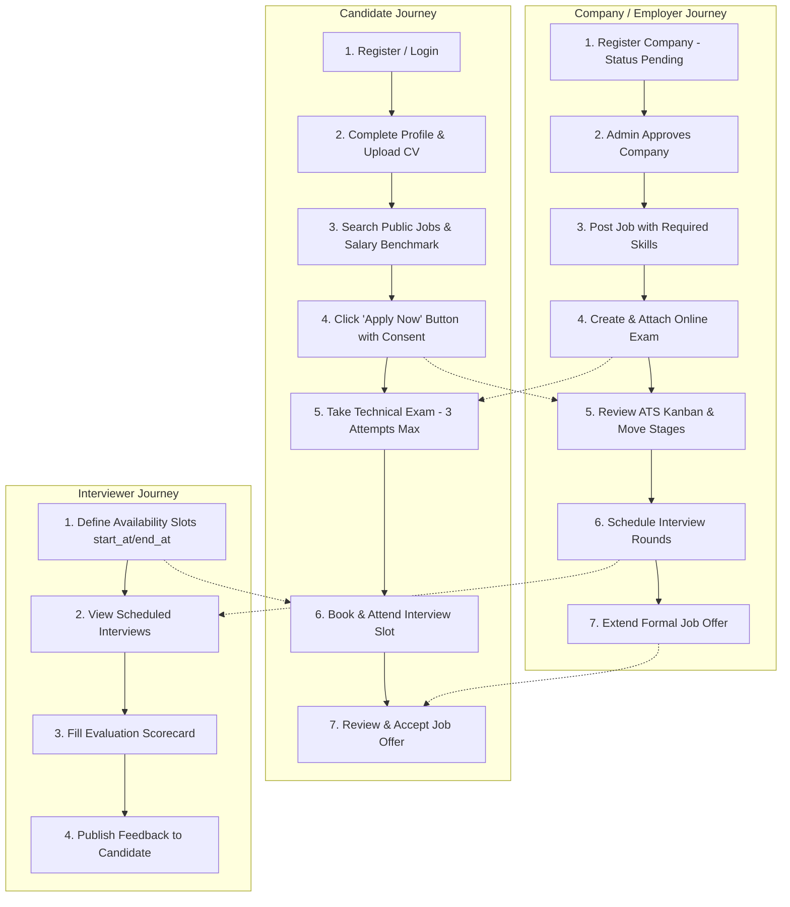

# HR Management & AI Recruitment System: Frontend Integration & Button-to-API Workflow Blueprint

---

## 1. Executive Summary & Frontend Architecture Overview

This document serves as the **official contract and blueprint for Frontend Engineers (React / Vue / Next.js / Mobile)** building client interfaces for the **HR Management & AI Recruitment System**.

### Core Frontend Principles
1. **API Base URL:** `http://127.0.0.1:8000/api` (Local Dev) or configured via `VITE_API_BASE_URL` / `NEXT_PUBLIC_API_BASE_URL`.
2. **Interactive Live Documentation:** Available at `http://127.0.0.1:8000/docs/api` (powered by Scramble / OpenAPI).
3. **OpenAPI Schema File:** `api.json` located in the root repository. You can generate TypeScript types instantly:
   ```bash
   npx openapi-typescript api.json -o src/types/api.d.ts
   ```
4. **Authentication Mechanism:** Pure **Bearer Token (Laravel Sanctum)**.
   - Upon successful login (`POST /api/auth/login`), store `access_token` in `localStorage` or secure cookie.
   - Send on every authenticated request in headers:
     ```http
     Authorization: Bearer <access_token>
     Accept: application/json
     ```
5. **Standard Error Handling:**
   - `401 Unauthorized`: Token expired or invalid -> Clear local state and redirect to `/login`.
   - `422 Unprocessable Content`: Validation errors -> Render errors under respective form input fields (`error.response.data.errors`).
   - `403 Forbidden`: Permission denied or limit reached (e.g. maximum exam attempts, or company is pending approval) -> Show alert toast.
   - `409 Conflict`: Duplicate action (e.g. applying twice to the same job, or submitting an already submitted exam) -> Show warning dialog.

---

## 2. Complete End-to-End System Workflow Map



---

## 3. UI Screen-by-Screen Button & Action Mapping

### 3.1. Authentication Screens

#### Screen 1: Candidate Registration (`/register/candidate`)
- **Trigger / Button:** Click **"Create Candidate Account"**
- **Method & Route:** `POST /api/auth/register/candidate`
- **Request Payload:**
  ```json
  {
    "name": "Ahmed Mostafa",
    "email": "ahmed@example.com",
    "password": "Password123!",
    "password_confirmation": "Password123!"
  }
  ```
- **Success Action (201):** Save `access_token` and `user` to Auth Store, show welcome toast, redirect to `/candidate/profile/setup`.

#### Screen 2: Company Registration (`/register/company`)
- **Trigger / Button:** Click **"Register Enterprise Account"**
- **Method & Route:** `POST /api/auth/register/company`
- **Request Payload (Multipart FormData):**
  ```text
  company_name: Acme Inc.
  owner_name: Tarek Ali
  email: tarek@acme.com
  password: Password123!
  password_confirmation: Password123!
  commercial_register: (PDF File binary)
  website: https://acme.com
  industry: Software Development
  ```
- **Success Action (201):** Save token, show notification: *"Company registered! Awaiting admin verification."*, redirect to `/company/dashboard`.

#### Screen 3: User Login (`/login`)
- **Trigger / Button:** Click **"Log In"**
- **Method & Route:** `POST /api/auth/login`
- **Request Payload:**
  ```json
  {
    "email": "user@example.com",
    "password": "Password123!"
  }
  ```
- **Success Action (200):**
  ```json
  {
    "message": "Login successful.",
    "user": {
      "id": 12,
      "name": "Tarek Ali",
      "email": "tarek@acme.com",
      "account_type": "company",
      "account_status": "Active",
      "roles": ["company_admin"],
      "company": {
        "id": 1,
        "name": "Acme Inc.",
        "status": "approved"
      }
    },
    "token": "1|abc123token..."
  }
  ```
  - If `account_type === 'candidate'` -> Redirect to `/jobs` or `/candidate/dashboard`.
  - If `account_type === 'company'` -> Redirect to `/company/jobs`.
  - Note: If `company.status === 'pending'`, show a banner: *"Your company account is currently under admin review."*

#### Screen 4: Logout Button (In Navbar / Header)
- **Trigger / Button:** Click **"Logout"**
- **Method & Route:** `POST /api/auth/logout` (Header: `Authorization: Bearer <token>`)
- **Success Action (200):** Wipe auth token from storage, reset state, redirect to `/login`.

---

### 3.2. Public Lookups & Taxonomy (For Dropdowns)

#### Screen 4b: Categories, Skills & Countries Lookups
- **Categories:** `GET /api/job-categories` -> Returns `[{ id: 1, name: "IT & Software" }, ...]`
- **Skills:** `GET /api/skills?q=lar` -> Returns `[{ id: 2, name: "Laravel", type: "tech" }, ...]`
- **Countries:** `GET /api/countries` -> Returns `[{ id: 1, name: "Egypt", code: "EG" }, ...]`

---

### 3.3. Candidate Portal Screens

#### Screen 5: Candidate Profile Page (`/candidate/profile`)
- **Event: Page Load**
  - **Method & Route:** `GET /api/candidate/profile`
  - **Action:** Populate Headline, Bio, Phone, Years of Experience, Experiences, Educations, Active CV.
- **Trigger / Button:** Click **"Save Profile Changes"**
  - **Method & Route:** `PUT /api/candidate/profile`
  - **Payload:**
    ```json
    {
      "headline": "Senior Full Stack Engineer",
      "bio": "5 years developing scalable SaaS applications.",
      "phone": "+201112223344",
      "years_experience": 5
    }
    ```
  - **Success Action (200):** Show toast: *"Profile updated successfully."*

#### Screen 6: CV Management Tab (`/candidate/cvs`)
- **Event: Page Load**
  - **Method & Route:** `GET /api/candidate/cvs`
  - **Action:** Render list of uploaded CV versions with download link, version number, and "Active" badge.
- **Trigger / Button:** Click **"Upload New CV"** (File Input onChange or Submit)
  - **Method & Route:** `POST /api/candidate/cvs`
  - **Headers:** `Content-Type: multipart/form-data`
  - **Payload:** FormData with `cv: (PDF or DOCX File)`
  - **Success Action (201):** Append new CV to list, mark as active version.
- **Trigger / Button:** Click **"Set as Active CV"**
  - **Method & Route:** `PATCH /api/candidate/cvs/{cvId}/set-active`
  - **Success Action (200):** Switch active badge to selected CV.
- **Trigger / Button:** Click **"Delete CV"**
  - **Method & Route:** `DELETE /api/candidate/cvs/{cvId}`
  - **Success Action (200):** Remove CV item from list.

#### Screen 7: Work Experience & Education Modals
- **Trigger / Button:** Click **"Add Experience"**
  - **Method & Route:** `POST /api/candidate/experiences`
  - **Payload:**
    ```json
    {
      "company_name": "Google",
      "job_title": "Software Engineer",
      "start_date": "2021-06-01",
      "end_date": null,
      "is_current": true,
      "description": "Building cloud microservices."
    }
    ```
- **Trigger / Button:** Click **"Add Education"**
  - **Method & Route:** `POST /api/candidate/educations`
  - **Payload:**
    ```json
    {
      "institution": "Cairo University",
      "degree": "B.Sc. in Computer Science",
      "field_of_study": "Information Technology",
      "graduation_year": 2021
    }
    ```

---

### 3.4. Job Discovery & Application Flow

#### Screen 8: Public Job Search & Filter Page (`/jobs`)
- **Event: Page Load / Filter Change**
  - **Method & Route:** `GET /api/jobs?q={search}&category_id={cat}&work_mode={mode}&salary_min={min}&page={page}`
  - **Action:** Render job cards with Company Name, Location, Salary Range, Work Mode badge.
- **Optional Helper:** Click **"View Salary Benchmark"**
  - **Method & Route:** `GET /api/salary-benchmark?job_title=Backend`
  - **Action:** Render market average min/max salary chart for that job role.

#### Screen 9: Job Details Page (`/jobs/:id`)
- **Event: Page Load**
  - **Method & Route:** `GET /api/jobs/{id}`
  - **Action:** Render full job description, required skills, company details, deadline.
- **Trigger / Button:** Click **"Apply for this Job"** Modal
  - **Method & Route:** `POST /api/jobs/{jobId}/apply`
  - **Request Payload:**
    ```json
    {
      "cover_note": "I have 5 years experience matching all required qualifications.",
      "cv_id": 4,
      "consent": true
    }
    ```
  - **Success Action (201):** Show modal: *"Application submitted successfully!"*, disable button, display status badge: `"Submitted"`.
  - **Error Action (409 Conflict):** Show alert: *"You already have an active application for this job."*

#### Screen 10: Candidate Applications Tracker (`/candidate/applications`)
- **Event: Page Load**
  - **Method & Route:** `GET /api/candidate/applications`
  - **Action:** Render table/cards of applications with status (`submitted`, `screening`, `shortlisted`, `interviewing`, `offered`, `hired`, `rejected`, `withdrawn`).
- **Trigger / Button:** Click **"View Application Details"**
  - **Method & Route:** `GET /api/candidate/applications/{id}`
  - **Action:** Show timeline history showing stage transitions and status notes.
- **Trigger / Button:** Click **"Withdraw Application"**
  - **Method & Route:** `DELETE /api/candidate/applications/{id}/withdraw`
  - **Success Action (200):** Update status to `"withdrawn"`, disable further actions.

---

### 3.5. Online Assessment & Exam Flow

#### Screen 11: Candidate Exam Room (`/candidate/exams/:examId/application/:applicationId`)
- **Trigger / Button:** Click **"Start Exam"**
  - **Method & Route:** `POST /api/candidate/exams/{examId}/applications/{applicationId}/start`
  - **Payload:**
    ```json
    {
      "camera_consent": true
    }
    ```
  - **Success Action (200):**
    - Returns attempt details (`attempt_no`, `time_limit_min`) and questions array.
    - **Security Feature:** Question options do **not** reveal the correct answer (`is_correct` is concealed).
    - Start client-side countdown timer matching `time_limit_min`.
  - **Error Action (403 Forbidden):** *"Maximum trial attempts (3 attempts) reached for this exam."*
- **Trigger / Button:** Click **"Submit Answers"** (or Timer Expiration)
  - **Method & Route:** `POST /api/candidate/exam-attempts/{attemptId}/submit`
  - **Payload:**
    ```json
    {
      "answers": [
        {
          "question_id": 1,
          "selected_option_id": 3
        },
        {
          "question_id": 2,
          "answer_text": "Laravel service providers register bindings in container."
        }
      ]
    }
    ```
  - **Success Action (200):**
    - Returns grading status:
      ```json
      {
        "message": "Exam attempt submitted and graded successfully.",
        "attempt_status": "submitted",
        "grading_status": "graded",
        "total_score": 85.0,
        "passing_score": 70.0,
        "is_passed": true
      }
      ```
    - Note: If exam contains written/coding questions, `grading_status` is `"pending_review"` and `is_passed` is `null`.

#### Screen 12: Exam Result Page (`/candidate/exam-attempts/:attemptId/result`)
- **Event: Page Load**
  - **Method & Route:** `GET /api/candidate/exam-attempts/{attemptId}/result`
  - **Action:** Display Passed/Failed badge, total score, passing threshold, and attempt number.

---

### 3.6. Interview Booking & Management

#### Screen 13: Candidate Interview Booking (`/candidate/interviews/booking`)
- **Event: Page Load**
  - **Method & Route:** `GET /api/candidate/available-slots?from=2026-11-01&to=2026-11-07`
  - **Action:** Render calendar / time slots picker of available interviewer slots. Returns array of slots with `id` (`availability_id`), `start_at`, `end_at`, `interviewer`.
- **Trigger / Button:** Select slot & Click **"Confirm Interview Booking"**
  - **Method & Route:** `POST /api/candidate/interviews/book`
  - **Payload:**
    ```json
    {
      "application_id": 1,
      "availability_id": 5,
      "interview_type": "online"
    }
    ```
  - **Success Action (201):** Show confirmed booking card with meeting details.

#### Screen 14: Candidate Interviews List (`/candidate/interviews`)
- **Event: Page Load**
  - **Method & Route:** `GET /api/candidate/interviews`
  - **Action:** List upcoming & past interviews with date, round name, and meeting URL.
- **Trigger / Button:** Click **"Reschedule"**
  - **Method & Route:** `POST /api/candidate/interviews/{id}/reschedule`
  - **Payload:** `{ "new_availability_id": 8 }`
- **Trigger / Button:** Click **"Cancel Interview"**
  - **Method & Route:** `POST /api/candidate/interviews/{id}/cancel`
  - **Payload:** `{ "reason": "Conflict with university exam" }`

---

### 3.7. Job Offers Flow

#### Screen 15: Candidate Job Offers Hub (`/candidate/offers`)
- **Event: Page Load**
  - **Method & Route:** `GET /api/candidate/offers`
  - **Action:** Render list of extended job offers with Job Title, Company, Salary, Start Date, and Status (`sent`, `accepted`, `rejected`).
- **Trigger / Button:** Click **"View Full Offer Letter"**
  - **Method & Route:** `GET /api/offers/{id}`
  - **Action:** Open offer details modal showing financial breakdown, terms, and expiration date.
- **Trigger / Button:** Click **"Accept Offer"**
  - **Method & Route:** `POST /api/candidate/offers/{id}/accept`
  - **Success Action (200):** Show celebration banner, update application status to `"hired"`.
- **Trigger / Button:** Click **"Decline Offer"**
  - **Method & Route:** `POST /api/candidate/offers/{id}/reject`
  - **Payload:** `{ "reason": "Accepted another offer with different location." }`
  - **Success Action (200):** Mark offer and application as `"rejected"`.

---

### 3.8. Company HR & Employer Screens

#### Screen 16: Company Post / Edit Job (`/company/jobs/create` & `/company/jobs/:id/edit`)
- **Trigger / Button:** Click **"Publish Job"**
  - **Method & Route:** `POST /api/company/jobs`
  - **Payload:**
    ```json
    {
      "company_id": 1,
      "category_id": 1,
      "title": "Senior Laravel Developer",
      "description": "Detailed description of role responsibilities and qualifications...",
      "work_mode": "hybrid",
      "employment_type": "full_time",
      "salary_min": 25000,
      "salary_max": 40000,
      "currency": "EGP",
      "salary_period": "month",
      "experience_years": 4,
      "department": "Engineering",
      "openings_count": 2,
      "deadline": "2026-12-31",
      "visibility": "public",
      "skills": [
        { "id": 1, "is_required": true },
        { "id": 2, "is_required": true }
      ]
    }
    ```
  - **Error Action (403 Forbidden):** If company status is `pending`, returns:
    `"Your company account is pending administrative approval. You cannot publish jobs until your account is approved."`
- **Trigger / Button:** Click **"Close Job"**
  - **Method & Route:** `PATCH /api/company/jobs/{id}/status`
  - **Payload:** `{ "status": "closed" }`

#### Screen 17: Company ATS Kanban Board (`/company/jobs/:jobId/pipeline`)
- **Event: Page Load**
  - **Method & Route:** `GET /api/company/jobs/{jobId}/applications`
  - **Action:** Render columns for `submitted`, `screening`, `shortlisted`, `interviewing`, `offered`, `hired`, `rejected`.
- **Trigger / Action:** Drag candidate card to next column OR Click **"Move Stage"**
  - **Method & Route:** `PATCH /api/company/applications/{id}/status`
  - **Payload:**
    ```json
    {
      "status": "shortlisted",
      "comment": "Strong technical portfolio."
    }
    ```
  - **Success Action (200):** Move card to new column, update applicant timeline.

#### Screen 18: Issue Job Offer Modal
- **Trigger / Button:** Click **"Send Formal Offer"** (from Candidate Application modal)
  - **Method & Route:** `POST /api/company/offers`
  - **Payload:**
    ```json
    {
      "application_id": 8,
      "salary_amount": 35000,
      "currency": "EGP",
      "salary_period": "month",
      "start_date": "2026-11-15",
      "expires_at": "2026-11-01 23:59:59"
    }
    ```
  - **Success Action (201):** Offer sent to candidate portal, application moves to `offered`.

#### Screen 19: Create Assessment Exam (`/company/exams/create`)
- **Trigger / Button:** Click **"Save Exam Setup"**
  - **Method & Route:** `POST /api/company/exams`
  - **Payload:**
    ```json
    {
      "company_id": 1,
      "title": "Backend Engineering MCQ Assessment",
      "time_limit_min": 45,
      "passing_score": 75,
      "attempt_limit": 3
    }
    ```
- **Trigger / Button:** Click **"Add Question"**
  - **Method & Route:** `POST /api/company/exams/{examId}/questions`
  - **Payload:**
    ```json
    {
      "question_type": "mcq",
      "content": "Which HTTP status code signifies resource conflict?",
      "points": 10,
      "options": [
        { "option_text": "400 Bad Request", "is_correct": false },
        { "option_text": "409 Conflict", "is_correct": true },
        { "option_text": "422 Unprocessable", "is_correct": false }
      ]
    }
    ```
- **Trigger / Button:** Click **"Attach Exam to Job"**
  - **Method & Route:** `POST /api/company/jobs/{jobId}/exams/{examId}/attach`

---

### 3.9. Interviewer Portal Screens

#### Screen 20: Interviewer Schedule & Availability (`/interviewer/availability`)
- **Trigger / Button:** Click **"Add Availability Slot"**
  - **Method & Route:** `POST /api/interviewer/availabilities`
  - **Payload:**
    ```json
    {
      "start_at": "2026-11-03 09:00:00",
      "end_at": "2026-11-03 17:00:00"
    }
    ```

#### Screen 21: Interview Evaluation Scorecard (`/interviewer/interviews/:id/evaluate`)
- **Event: Page Load**
  - **Method & Route:** `GET /api/interviewer/interviews/{id}`
  - **Action:** Display Candidate CV, Job Title, Interview Questions list.
- **Trigger / Button:** Click **"Save Evaluation"**
  - **Method & Route:** `POST /api/interviews/{id}/evaluations`
  - **Payload:**
    ```json
    {
      "numeric_score": 85,
      "internal_notes": "Deep knowledge of system design and MySQL indexing.",
      "candidate_feedback": "Strong communication and problem solving."
    }
    ```
- **Trigger / Button:** Click **"Publish Evaluation to Candidate"**
  - **Method & Route:** `POST /api/interviews/{id}/evaluations/{evaluationId}/publish`
  - **Success Action (200):** Feedback becomes visible to candidate on their interview details page.

---

## 4. Frontend State & Quick Reference Checklist

| User Journey | Key State To Store In Client Store | Primary Route |
| :--- | :--- | :--- |
| **Auth** | `token`, `user`, `user.account_type`, `user.company` | `POST /api/auth/login` |
| **Lookups** | `categories`, `skills`, `countries` | `GET /api/job-categories`, `/skills`, `/countries` |
| **Candidate Profile** | `profile`, `profile.cvs`, `profile.experiences` | `GET /api/candidate/profile` |
| **Job Search** | `jobs`, `pagination`, `filters` | `GET /api/jobs` |
| **Job Apply** | `selectedCvId`, `coverNote`, `consent` | `POST /api/jobs/{id}/apply` |
| **Active Exam** | `attemptId`, `remainingSeconds`, `cameraConsent` | `POST /api/candidate/exams/{id}/start` |
| **ATS Kanban** | `applicationsByStatus: { submitted: [], ... }` | `GET /api/company/jobs/{id}/applications` |
| **Offer** | `offerDetails`, `status: 'sent'` | `GET /api/offers/{id}` |

---

## 5. Live Testing in Browser
The entire frontend team can test every single button and payload live right now:
1. Start the server: `php artisan serve`
2. Open browser: `http://127.0.0.1:8000/docs/api`
3. Click any endpoint -> Select **"Send API Request"** to see the real response immediately!
