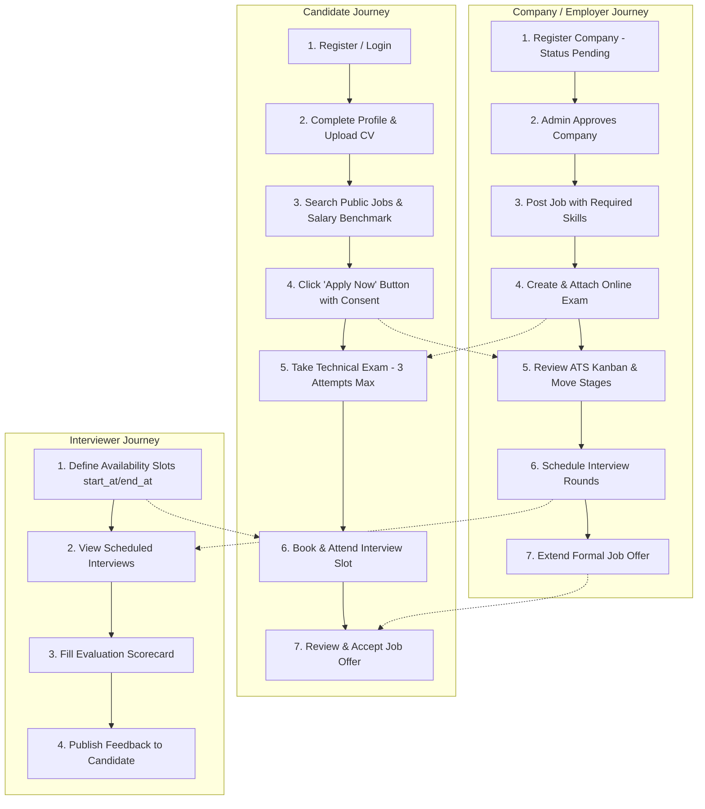

# HR Management & AI Recruitment System: Frontend Integration & Button-to-API Workflow Blueprint

---

## 1. Executive Summary & Frontend Architecture Overview

This document serves as the **official contract and blueprint for Frontend Engineers (React / Vue / Next.js / Mobile)** building client interfaces for the **HR Management & AI Recruitment System**.

### Core Frontend Principles
1. **API Base URL:** `http://127.0.0.1:8000/api` (Local Dev) or configured via `VITE_API_BASE_URL` / `NEXT_PUBLIC_API_BASE_URL`.
2. **Interactive Live Documentation:** Available at `http://127.0.0.1:8000/docs/api` (powered by Scramble / OpenAPI).
3. **OpenAPI Schema File:** `api.json` located in the root repository. You can generate TypeScript types instantly:
   ```bash
   npx openapi-typescript api.json -o src/types/api.d.ts
   ```
4. **Authentication Mechanism:** Pure **Bearer Token (Laravel Sanctum)**.
   - Upon successful login (`POST /api/auth/login`), store `access_token` in `localStorage` or secure cookie.
   - Send on every authenticated request in headers:
     ```http
     Authorization: Bearer <access_token>
     Accept: application/json
     ```
5. **Standard Error Handling:**
   - `401 Unauthorized`: Token expired or invalid -> Clear local state and redirect to `/login`.
   - `422 Unprocessable Content`: Validation errors -> Render errors under respective form input fields (`error.response.data.errors`).
   - `403 Forbidden`: Permission denied or limit reached (e.g. maximum exam attempts, or company is pending approval) -> Show alert toast.
   - `409 Conflict`: Duplicate action (e.g. applying twice to the same job, or submitting an already submitted exam) -> Show warning dialog.

### Canonical response-envelope map

The table below documents the primary success key for every API endpoint family. Laravel resource collections and single resources use `data`; custom JSON responses use the named key shown below. Error responses use `message` and may include `errors` or `allowed_transitions`.

| Endpoint(s) | Primary success key(s) |
|---|---|
| `GET /api` | `status`, `message` |
| `GET /api/hello` | `message` |
| `GET /api/jobs`, `GET /api/jobs/{job}` | `data` |
| `GET /api/companies`, `GET /api/companies/{id}`, `GET /api/companies/{id}/jobs` | `data` |
| `GET /api/public/featured` | `featured_companies`, `featured_jobs`, `counts` |
| `GET /api/job-categories`, `GET /api/skills`, `GET /api/countries` | `data` |
| `GET /api/salary-benchmark` | `market_summary`, `records` |
| `POST /api/auth/register/candidate` | `user`, `access_token`, `token`, `token_type` |
| `POST /api/auth/register/company` | `user`, `company`, `access_token`, `token`, `token_type` |
| `POST /api/auth/email/verify` | `message`, `user` |
| `POST /api/auth/email/resend` | `message` (rate-limit errors also include `retry_after`) |
| `PATCH /api/auth/me/preferences` | `message`, `preferences` |
| `POST /api/candidate/profile/photo` | `data` (`CandidateProfileResource`) |
| `DELETE /api/candidate/profile/photo` | `message` |
| `POST /api/auth/register/employee` | `user`, `access_token`, `token` |
| `POST /api/auth/login`, `POST /api/admin/login` | `access_token`, `token`, `token_type`; user login also returns `user`, admin login returns `admin` |
| `GET /api/auth/me` | `data` |
| `GET /api/admin/me` | `admin`, `user` |
| `POST /api/auth/logout`, `POST /api/admin/logout` | `message` |
| `GET|PUT /api/candidate/profile` | `data` |
| `GET|PUT /api/candidate/onboarding`, `GET|PUT /api/candidate/preferences` | `data` |
| `GET|PUT /api/candidate/notification-settings`, `GET|PUT /api/candidate/privacy` | `data` |
| `GET /api/candidate/profile/preview`, `GET /api/candidate/dashboard` | `data` |
| `GET|POST|PUT|DELETE /api/candidate/saved-searches` | `data` |
| `GET /api/candidate/recommended-jobs`, `GET /api/candidate/saved-jobs` | `data` |
| `POST /api/candidate/recommended-jobs/{jobId}/hide` | `data`, `message` |
| Candidate CV, experience and education CRUD endpoints | `data` for resources/collections; delete endpoints return `message` |
| `GET /api/candidate/applications`, `GET /api/candidate/applications/{id}` | `data` |
| `POST /api/jobs/{jobId}/apply`, `PATCH /api/company/applications/{id}/status` | `application` |
| `DELETE /api/candidate/applications/{id}/withdraw` | `message` |
| Candidate interview list/detail/book/reschedule/cancel endpoints | `data` |
| Candidate exam start | `attempt`, `questions` |
| Candidate exam submit/result | `attempt_status`, `grading_status`, `total_score`, `attempt` and result fields |
| `GET /api/candidate/offers`, `GET /api/offers/{id}` | `data` |
| Candidate offer accept/reject | `offer` |
| Interviewer availability and interview endpoints | `data` |
| `POST /api/company/join-requests`, employee approve/reject/remove | `employee`; delete also returns `message` |
| `GET /api/company/employees`, `GET /api/company/employees/{id}` | `data` |
| `GET /api/company/jobs`, `GET /api/company/jobs/{id}` | `data` |
| `POST /api/company/jobs`, `PUT /api/company/jobs/{id}`, job status change | `job` |
| `DELETE /api/company/jobs/{id}` | `message` |
| Interview-round CRUD endpoints | `data` and compatibility alias `round` on single/create/update responses |
| `POST /api/company/applications/{id}/interviews`, `GET /api/company/interviews`, company interview cancel | `data` |
| Company application list/detail | `data` |
| Company exam create/question create | `exam` or `question` |
| `POST /api/company/jobs/{jobId}/exams/{examId}/attach` | `job_id`, `exam_id`, `stage_order`, `message` |
| `POST /api/company/offers` | `offer` |
| Admin company review endpoints | `company` |
| Admin user status/role endpoints | `user` or `message` |
| `GET /api/admin/users`, `GET /api/admin/roles`, `GET /api/admin/audit-logs` | `data` |
| Interview scheduling and evaluation endpoints under `/api/interviews` | `data` |

For authentication, `access_token` is the canonical key. `token` remains as a backwards-compatible alias and has the same value.

---

## 2. Complete End-to-End System Workflow Map



---

## 3. UI Screen-by-Screen Button & Action Mapping

### 3.1. Authentication Screens

#### Screen 1: Candidate Registration (`/register/candidate`)
- **Trigger / Button:** Click **"Create Candidate Account"**
- **Method & Route:** `POST /api/auth/register/candidate`
- **Request Payload:**
  ```json
  {
    "name": "Ahmed Mostafa",
    "email": "ahmed@example.com",
    "password": "Password123!",
    "password_confirmation": "Password123!"
  }
  ```
- **Success Action (201):** Save `access_token` and `user` to Auth Store, show welcome toast, redirect to `/candidate/profile/setup`.

#### Screen 2: Company Registration (`/register/company`)
- **Trigger / Button:** Click **"Register Enterprise Account"**
- **Method & Route:** `POST /api/auth/register/company`
- **Request Payload (JSON):**
  ```json
  {
    "company_name": "Acme Inc.",
    "name": "Tarek Ali",
    "email": "tarek@acme.com",
    "password": "Password123!",
    "password_confirmation": "Password123!",
    "website": "https://acme.com",
    "industry": "Software Development",
    "contact_email": "contact@acme.com",
    "contact_phone": "+201000000000",
    "address": "Cairo, Egypt"
  }
  ```
- **Success Action (201):** Save token, show notification: *"Company registered! Awaiting admin verification."*, redirect to `/company/dashboard`.

The optional contact fields accepted by this endpoint are `contact_email`, `contact_phone`, and `address`.

#### Screen 2a: Email Verification
- **Resend code:** `POST /api/auth/email/resend` with `{ "email": "tarek@acme.com" }`.
- **Verify code:** `POST /api/auth/email/verify` with `{ "email": "tarek@acme.com", "code": "123456" }`.
- The code is six digits, expires after 10 minutes, and can be used once. Resend is limited to 3 requests per minute per user.
- Successful verification returns `200`, sets `user.email_verified_at`, and returns the updated user.
- Unknown/already-verified resend requests return a generic `200`; invalid or expired codes return `422`; rate-limited resend returns `429` with `retry_after` seconds.
- Real email delivery requires SMTP/mail configuration and a running queue worker because the verification mailable is queued.

#### Screen 2b: Account Preferences
- **Method & Route:** `PATCH /api/auth/me/preferences` (Bearer token required)
- **Payload:** `{ "locale": "en", "theme": "dark" }`
- Both fields are optional, but at least one is required. `theme` accepts `system`, `light`, or `dark`. The response key is `preferences`.

#### Screen 2c: Candidate Profile Photo
- **Upload:** `POST /api/candidate/profile/photo` (Bearer token, `multipart/form-data`), form field `photo` (JPG/JPEG/PNG/WEBP, maximum 5 MB).
- **Delete:** `DELETE /api/candidate/profile/photo` (Bearer token).
- Upload returns `201` with `data.photo_path` and `data.photo_url`; delete clears the stored file and returns `200` with `message`.

#### Screen 3: User Login (`/login`)
- **Trigger / Button:** Click **"Log In"**
- **Method & Route:** `POST /api/auth/login`
- **Request Payload:**
  ```json
  {
    "email": "user@example.com",
    "password": "Password123!"
  }
  ```
- **Success Action (200):**
  ```json
  {
    "message": "Login successful.",
    "user": {
      "id": 12,
      "name": "Tarek Ali",
      "email": "tarek@acme.com",
      "account_type": "company",
      "account_status": "Active",
      "roles": ["company_admin"],
      "company": {
        "id": 1,
        "name": "Acme Inc.",
        "status": "approved"
      }
    },
    "access_token": "1|abc123token...",
    "token": "1|abc123token...",
    "token_type": "Bearer"
  }
  ```
  - If `account_type === 'candidate'` -> Redirect to `/jobs` or `/candidate/dashboard`.
  - If `account_type === 'company'` -> Redirect to `/company/jobs`.
  - `access_token` is the canonical token key. `token` is retained as a compatibility alias with the same value.
  - Note: If `company.status === 'pending'`, show a banner: *"Your company account is currently under admin review."*

#### Screen 4: Logout Button (In Navbar / Header)
- **Trigger / Button:** Click **"Logout"**
- **Method & Route:** `POST /api/auth/logout` (Header: `Authorization: Bearer <token>`)
- **Success Action (200):** Wipe auth token from storage, reset state, redirect to `/login`.

#### Screen 4a: Account Security & Deletion
- **Change Password (canonical):** `PUT /api/auth/change-password`
  - Payload: `current_password`, `new_password`, `new_password_confirmation`.
  - The existing `/api/candidate/change-password` and `/api/company/change-password` paths remain compatibility aliases for the same action.
- **Delete Account (canonical):** `DELETE /api/auth/account`
  - The existing `/api/candidate/account` and `/api/company/delete-account` paths remain compatibility aliases.
  - The authenticated user account is soft-deleted and its Sanctum tokens are revoked. Platform admin accounts must use the separate admin lifecycle.
- **Reset Password:** `POST /api/auth/reset-password` remains canonical. `POST /api/company/reset-password` is supported as a compatibility alias.

---

### 3.2. Public Lookups & Taxonomy (For Dropdowns)

#### Screen 4b: Categories, Skills & Countries Lookups
- **Categories:** `GET /api/job-categories` -> Returns `[{ id: 1, name: "IT & Software" }, ...]`
- **Skills:** `GET /api/skills?q=lar` -> Returns `[{ id: 2, name: "Laravel", type: "tech" }, ...]`
- **Countries:** `GET /api/countries` -> Returns `[{ id: 1, name: "Egypt", code: "EG" }, ...]`

---

### 3.3. Candidate Portal Screens

#### Screen 5: Candidate Profile Page (`/candidate/profile`)
- **Event: Page Load**
  - **Method & Route:** `GET /api/candidate/profile`
  - **Action:** Populate Headline, Bio, Phone, Years of Experience, Experiences, Educations, Active CV.
- **Trigger / Button:** Click **"Save Profile Changes"**
  - **Method & Route:** `PUT /api/candidate/profile`
  - **Payload:**
    ```json
    {
      "headline": "Senior Full Stack Engineer",
      "bio": "5 years developing scalable SaaS applications.",
      "phone": "+201112223344",
      "years_experience": 5
    }
    ```
  - **Success Action (200):** Show toast: *"Profile updated successfully."*

#### Screen 5a: Candidate Onboarding
- **Read:** `GET /api/candidate/onboarding`
- **Save:** `PUT /api/candidate/onboarding`
- **Payload:**
  ```json
  {
    "steps": {
      "basics": { "completed": true },
      "resume_import": { "completed": true },
      "skills_preferences": { "completed": false }
    }
  }
  ```
- The backend calculates `data.completion_percent` from the three steps; the frontend does not send or calculate the percentage.

#### Screen 5b: Candidate Job Preferences
- **Read/Save:** `GET|PUT /api/candidate/preferences`
- **Payload fields:** `desired_titles[]`, `location`, `employment_type`, `min_salary`, `work_model` (`onsite|remote|hybrid`), `open_to_relocation`, and `include_agency`.

#### Screen 5c: Notification and Privacy Settings
- **Notifications:** `GET|PUT /api/candidate/notification-settings`
  - Fields: `weekly_digest`, `status_updates`, `interview_reminders`, `messages`, `marketing`.
- **Privacy:** `GET|PUT /api/candidate/privacy`
  - Fields: `visibility` (`public|employers_only|private`), `allow_agency_recruiters`, `show_in_public_search`.
- All four settings endpoints require the candidate Bearer token and return the saved values under `data`.

#### Screen 5d: Employer Preview and Candidate Dashboard
- **Employer-safe profile preview:** `GET /api/candidate/profile/preview`
  - Returns public professional fields, skills, experiences, education, and active CV metadata.
  - It intentionally omits email and phone from the preview response.
- **Candidate dashboard:** `GET /api/candidate/dashboard`
  - Returns one `data` object containing `profile_completion_percent`, `next_interview`, `active_applications`, and `next_actions`.
  - The dashboard endpoint is read-only; use the dedicated settings/profile/application endpoints for changes.

#### Screen 6: CV Management Tab (`/candidate/cvs`)
- **Event: Page Load**
  - **Method & Route:** `GET /api/candidate/cvs`
  - **Action:** Render list of uploaded CV versions with download link, version number, and "Active" badge.
- **Trigger / Button:** Click **"Upload New CV"** (File Input onChange or Submit)
  - **Method & Route:** `POST /api/candidate/cvs`
  - **Headers:** `Content-Type: multipart/form-data`
  - **Payload:** FormData with `cv: (PDF or DOCX File)`
  - **Success Action (201):** Append new CV to list, mark as active version.
- **Trigger / Button:** Click **"Set as Active CV"**
  - **Method & Route:** `PATCH /api/candidate/cvs/{cvId}/set-active`
  - **Success Action (200):** Switch active badge to selected CV.
- **Trigger / Button:** Click **"Delete CV"**
  - **Method & Route:** `DELETE /api/candidate/cvs/{cvId}`
  - **Success Action (200):** Remove CV item from list.

#### Screen 7: Work Experience & Education Modals
- **Trigger / Button:** Click **"Add Experience"**
  - **Method & Route:** `POST /api/candidate/experiences`
  - **Payload:**
    ```json
    {
      "company_name": "Google",
      "job_title": "Software Engineer",
      "start_date": "2021-06-01",
      "end_date": null,
      "is_current": true,
      "description": "Building cloud microservices."
    }
    ```
- **Trigger / Button:** Click **"Add Education"**
  - **Method & Route:** `POST /api/candidate/educations`
  - **Payload:**
    ```json
    {
      "institution": "Cairo University",
      "degree": "B.Sc. in Computer Science",
      "field_of_study": "Information Technology",
      "graduation_year": 2021
    }
    ```
- **Edit Experience:** `PUT /api/candidate/experiences/{id}` with any fields from the create payload.
- **Edit Education:** `PUT /api/candidate/educations/{id}` with any fields from the create payload.
- Both update endpoints verify that the record belongs to the authenticated candidate and return `404` for another candidate's record.

---

### 3.4. Job Discovery & Application Flow

#### Screen 8: Public Job Search & Filter Page (`/jobs`)
- **Event: Page Load / Filter Change**
  - **Method & Route:** `GET /api/jobs?q={search}&employment_type[]=full_time&employment_type[]=contract&work_mode[]=remote&work_mode[]=hybrid&category_id={cat}&salary_min={min}&salary_max={max}&page={page}`
  - `discipline` is also accepted as an alias for `category_id`.
  - **Action:** Render job cards with Company Name, Location, Salary Range, Work Mode badge, hiring model, requisition code, posted date, `saved_by_me`, and `applied_by_me`.
  - **Response:** `data` is paginated job resources. The top-level response also includes `total_count` and `facets` (`employment_type`, `work_mode`, and `category`) for filter controls. `employment_type[]` and `work_mode[]` may be repeated query parameters; scalar values remain accepted for compatibility.
- **Optional Helper:** Click **"View Salary Benchmark"**
  - **Method & Route:** `GET /api/salary-benchmark?job_title=Backend`
  - **Action:** Render market average min/max salary chart for that job role.

#### Screen 9: Job Details Page (`/jobs/:id`)
- **Event: Page Load**
  - **Method & Route:** `GET /api/jobs/{id}`
  - **Action:** Render full job description, required skills, deadline, hiring model, requisition code, salary summary, hiring contact, company about data, and candidate state (`saved_by_me`, `applied_by_me`).
- **Trigger / Button:** Click **"Apply for this Job"** Modal
  - **Method & Route:** `POST /api/jobs/{jobId}/apply`
  - **Request Payload:**
    ```json
    {
      "cover_note": "I have 5 years experience matching all required qualifications.",
      "cv_id": 4,
      "consent": true
    }
    ```
  - **Success Action (201):** Show modal: *"Application submitted successfully!"*, disable button, display status badge: `"Submitted"`.
  - **Error Action (409 Conflict):** Show alert: *"You already have an active application for this job."*

#### Screen 9a: Public Companies and Featured Home (`/companies`, `/companies/:id`)
- **Company list:** `GET /api/companies` returns approved public companies under `data` with pagination.
- **Company page:** `GET /api/companies/{id}` returns the approved company's description, culture, benefits, locations, social links, hiring team, and `open_roles_count` under `data`.
- **Company jobs:** `GET /api/companies/{id}/jobs` returns that company's available public roles under `data`; candidate users also receive `saved_by_me` and `applied_by_me` on each job.
- **Featured home content:** `GET /api/public/featured` returns `featured_companies`, `featured_jobs`, and `counts` under the response root. This endpoint is public and only includes approved companies and available jobs.

#### Screen 9b: Saved Searches, Recommendations, and Saved Jobs
- **Saved search list/create:** `GET|POST /api/candidate/saved-searches`.
- **Saved search update/delete:** `PUT|DELETE /api/candidate/saved-searches/{id}`. Create/update payload:
  ```json
  {
    "name": "Remote backend roles",
    "filters": {"q": "backend", "work_mode": ["remote"], "salary_min": 15000},
    "weekly_alerts": true,
    "is_paused": false
  }
  ```
- **Recommendations:** `GET /api/candidate/recommended-jobs?hide_irrelevant=true&include_applied=true`. Each job includes `why_it_fits` (array of reasons), `already_applied`/`applied_by_me`, and `hide_irrelevant` is enabled by default. `include_applied` is optional and defaults to `false` for compatibility.
- **Hide a recommendation:** `POST /api/candidate/recommended-jobs/{jobId}/hide` with optional `{ "reason": "Not relevant" }`. The operation is idempotent for the same candidate/job.
- **Saved jobs:** `GET /api/candidate/saved-jobs?work_model=remote&sort=updated_desc`. Supported sort values are `updated_desc` and `title_asc`; each result includes `updated_since_saved` and `updated_since_saved_reason`.

#### Screen 10: Candidate Applications Tracker (`/candidate/applications`)
- **Event: Page Load**
  - **Method & Route:** `GET /api/candidate/applications`
  - **Action:** Render table/cards of applications with status (`submitted`, `screening`, `shortlisted`, `interviewing`, `offered`, `hired`, `rejected`, `withdrawn`).
- **Trigger / Button:** Click **"View Application Details"**
  - **Method & Route:** `GET /api/candidate/applications/{id}`
  - **Action:** Show timeline history showing stage transitions and status notes.
- **Trigger / Button:** Click **"Withdraw Application"**
  - **Method & Route:** `DELETE /api/candidate/applications/{id}/withdraw`
  - **Success Action (200):** Update status to `"withdrawn"`, disable further actions.

---

### 3.5. Online Assessment & Exam Flow

#### Screen 10A: Candidate Exams List (`/candidate/exams`)
- **Event: Page Load**
  - **Method & Route:** `GET /api/candidate/exams`
  - **Access:** Bearer token for a candidate.
  - **Behavior:** Returns published exams attached to jobs the candidate applied to. Exams from unrelated jobs and draft exams are excluded.

#### Screen 11: Candidate Exam Room (`/candidate/exams/:examId/application/:applicationId`)
- **Trigger / Button:** Click **"Start Exam"**
  - **Method & Route:** `POST /api/candidate/exams/{examId}/applications/{applicationId}/start`
  - **Payload:**
    ```json
    {
      "camera_consent": true
    }
    ```
  - **Success Action (200):**
    - Returns attempt details (`attempt_no`, `time_limit_min`) and questions array.
    - **Security Feature:** Question options do **not** reveal the correct answer (`is_correct` is concealed).
    - Start client-side countdown timer matching `time_limit_min`.
  - **Error Action (403 Forbidden):** *"Maximum trial attempts (3 attempts) reached for this exam."*
- **Trigger / Button:** Click **"Submit Answers"** (or Timer Expiration)
  - **Method & Route:** `POST /api/candidate/exam-attempts/{attemptId}/submit`
  - **Payload:**
    ```json
    {
      "answers": [
        {
          "question_id": 1,
          "selected_option_id": 3
        },
        {
          "question_id": 2,
          "answer_text": "Laravel service providers register bindings in container."
        }
      ]
    }
    ```
  - **Success Action (200):**
    - Returns grading status:
      ```json
      {
        "message": "Exam attempt submitted and graded successfully.",
        "attempt_status": "submitted",
        "grading_status": "graded",
        "total_score": 85.0,
        "passing_score": 70.0,
        "is_passed": true
      }
      ```
    - Note: If exam contains written/coding questions, `grading_status` is `"pending_review"` and `is_passed` is `null`.

#### Screen 12: Exam Result Page (`/candidate/exam-attempts/:attemptId/result`)
- **Event: Page Load**
  - **Method & Route:** `GET /api/candidate/exam-attempts/{attemptId}/result`
  - **Action:** Display Passed/Failed badge, total score, passing threshold, and attempt number.

---

### 3.6. Interview Booking & Management

#### Screen 13: Candidate Interview Booking (`/candidate/interviews/booking`)
- **Event: Page Load**
  - **Method & Route:** `GET /api/candidate/available-slots?from=2026-11-01&to=2026-11-07`
  - **Action:** Render calendar / time slots picker of available interviewer slots. Returns array of slots with `id` (`availability_id`), `start_at`, `end_at`, `interviewer`.
- **Trigger / Button:** Select slot & Click **"Confirm Interview Booking"**
  - **Method & Route:** `POST /api/candidate/interviews/book`
  - **Payload:**
    ```json
    {
      "application_id": 1,
      "availability_id": 5,
      "interview_type": "online"
    }
    ```
  - **Success Action (201):** Show confirmed booking card with meeting details.

#### Screen 14: Candidate Interviews List (`/candidate/interviews`)
- **Event: Page Load**
  - **Method & Route:** `GET /api/candidate/interviews`
  - **Action:** List upcoming & past interviews with date, round name, and meeting URL.
- **Trigger / Button:** Click **"Reschedule"**
  - **Method & Route:** `POST /api/candidate/interviews/{id}/reschedule`
  - **Payload:** `{ "new_availability_id": 8 }`
- **Trigger / Button:** Click **"Cancel Interview"**
  - **Method & Route:** `POST /api/candidate/interviews/{id}/cancel`
  - **Payload:** `{ "reason": "Conflict with university exam" }`

---

### 3.7. Job Offers Flow

#### Screen 15: Candidate Job Offers Hub (`/candidate/offers`)
- **Event: Page Load**
  - **Method & Route:** `GET /api/candidate/offers`
  - **Action:** Render list of extended job offers with Job Title, Company, Salary, Start Date, and Status (`sent`, `accepted`, `rejected`).
- **Trigger / Button:** Click **"View Full Offer Letter"**
  - **Method & Route:** `GET /api/offers/{id}`
  - **Action:** Open offer details modal showing financial breakdown, terms, and expiration date.
- **Trigger / Button:** Click **"Accept Offer"**
  - **Method & Route:** `POST /api/candidate/offers/{id}/accept`
  - **Success Action (200):** Show celebration banner, update application status to `"hired"`.
- **Trigger / Button:** Click **"Decline Offer"**
  - **Method & Route:** `POST /api/candidate/offers/{id}/reject`
  - **Payload:** `{ "reason": "Accepted another offer with different location." }`
  - **Success Action (200):** Mark offer and application as `"rejected"`.

---

### 3.8. Company HR & Employer Screens

#### Screen 16: Company Post / Edit Job (`/company/jobs/create` & `/company/jobs/:id/edit`)
- **Trigger / Button:** Click **"Publish Job"**
  - **Method & Route:** `POST /api/company/jobs`
  - **Payload:**
    ```json
    {
      "category_id": 1,
      "title": "Senior Laravel Developer",
      "description": "Detailed description of role responsibilities and qualifications...",
      "location": "Riyadh, Saudi Arabia",
      "work_mode": "hybrid",
      "employment_type": "full_time",
      "salary_min": 25000,
      "salary_max": 40000,
      "currency": "SAR",
      "salary_period": "month",
      "experience_years": 4,
      "department": "Engineering",
      "openings_count": 2,
      "deadline": "2026-12-31",
      "visibility": "public",
      "private_apply_mode": null,
      "skills": [
        { "skill_id": 1, "is_required": true },
        { "skill_id": 2, "is_required": false }
      ]
    }
    ```
  - To create an internal company-only opening, send "visibility": "private" and optionally "private_apply_mode": "all_employees" (the default). It will not appear in the public GET /api/jobs endpoints.
  - Approved company members can list internal openings with GET /api/company/internal-jobs and view one with GET /api/company/internal-jobs/{id}. Jobs using private_apply_mode: "nominated_only" are visible only to approved employees nominated for that job.
  - `StoreJobRequest` accepts the canonical names `category_id`, `work_mode`, `salary_min`, `salary_max`, and `location`. The legacy aliases `job_category_id`, `workplace_type`, `min_salary`, `max_salary`, `city`, and `country_id` are rejected and must not be sent.
  - **Error Action (403 Forbidden):** If company status is `pending`, returns:
    `"Your company account is pending administrative approval. You cannot publish jobs until your account is approved."`
- **Trigger / Button:** Click **"Close Job"**
  - **Method & Route:** `PATCH /api/company/jobs/{id}/status`
  - **Payload:** `{ "status": "closed" }`

#### Screen 17: Company ATS Kanban Board (`/company/jobs/:jobId/pipeline`)
- **Event: Page Load**
  - **Method & Route:** `GET /api/company/jobs/{jobId}/applications`
  - **Action:** Render columns for `submitted`, `screening`, `shortlisted`, `interviewing`, `offered`, `hired`, `rejected`.
- **Trigger / Action:** Drag candidate card to next column OR Click **"Move Stage"**
  - **Method & Route:** `PATCH /api/company/applications/{id}/status`
  - **Payload:**
    ```json
    {
      "status": "shortlisted",
      "comment": "Strong technical portfolio."
    }
    ```
  - **Success Action (200):** Move card to new column, update applicant timeline.
  - **Allowed stage transitions:** `submitted -> screening|shortlisted|rejected|withdrawn`; `screening -> shortlisted|rejected|withdrawn`; `shortlisted -> interviewing|rejected|withdrawn`; `interviewing -> offered|rejected|withdrawn`; `offered -> hired|rejected|withdrawn`. `rejected`, `hired`, and `withdrawn` are terminal. Invalid transitions return `409` with `message` and `allowed_transitions`.

#### Screen 18: Issue Job Offer Modal
- **Trigger / Button:** Click **"Send Formal Offer"** (from Candidate Application modal)
  - **Method & Route:** `POST /api/company/offers`
  - **Payload:**
    ```json
    {
      "application_id": 8,
      "salary_amount": 35000,
      "currency": "EGP",
      "salary_period": "month",
      "start_date": "2026-11-15",
      "expires_at": "2026-11-01 23:59:59"
    }
    ```
  - **Success Action (201):** Offer sent to candidate portal, application moves to `offered`.

#### Screen 19: Create Assessment Exam (`/company/exams/create`)
- **Event: Page Load / Exam Details**
  - **List:** `GET /api/company/exams`
  - **Details:** `GET /api/company/exams/{examId}`
  - **Behavior:** Both endpoints are scoped to the authenticated company. Details include the exam questions and options.
- **Trigger / Button:** Click **"Save Exam Setup"**
  - **Method & Route:** `POST /api/company/exams`
  - **Payload:**
    ```json
    {
      "company_id": 1,
      "title": "Backend Engineering MCQ Assessment",
      "time_limit_min": 45,
      "passing_score": 75,
      "attempt_limit": 3
    }
    ```
- **Trigger / Button:** Click **"Add Question"**
  - **Method & Route:** `POST /api/company/exams/{examId}/questions`
  - **Payload:**
    ```json
    {
      "question_type": "mcq",
      "content": "Which HTTP status code signifies resource conflict?",
      "points": 10,
      "options": [
        { "option_text": "400 Bad Request", "is_correct": false },
        { "option_text": "409 Conflict", "is_correct": true },
        { "option_text": "422 Unprocessable", "is_correct": false }
      ]
    }
    ```
- **Trigger / Button:** Click **"Attach Exam to Job"**
  - **Method & Route:** `POST /api/company/jobs/{jobId}/exams/{examId}/attach`

---

### 3.9. Interviewer Portal Screens

#### Screen 20: Interviewer Schedule & Availability (`/interviewer/availability`)
- **Trigger / Button:** Click **"Add Availability Slot"**
  - **Method & Route:** `POST /api/interviewer/availabilities`
  - **Payload:**
    ```json
    {
      "start_at": "2026-11-03 09:00:00",
      "end_at": "2026-11-03 17:00:00"
    }
    ```

#### Screen 21: Interview Evaluation Scorecard (`/interviewer/interviews/:id/evaluate`)
- **Event: Page Load**
  - **Method & Route:** `GET /api/interviewer/interviews/{id}`
  - **Action:** Display Candidate CV, Job Title, Interview Questions list.
- **Trigger / Button:** Click **"Save Evaluation"**
  - **Method & Route:** `POST /api/interviews/{id}/evaluations`
  - **Payload:**
    ```json
    {
      "numeric_score": 85,
      "internal_notes": "Deep knowledge of system design and MySQL indexing.",
      "candidate_feedback": "Strong communication and problem solving."
    }
    ```
- **Trigger / Button:** Click **"Publish Evaluation to Candidate"**
  - **Method & Route:** `POST /api/interviews/{id}/evaluations/{evaluationId}/publish`
  - **Success Action (200):** Feedback becomes visible to candidate on their interview details page.

---

### 3.10. Admin Portal Screens & Workflow

#### Screen 22: Platform Admin Login (`/admin/login`)
- **Trigger / Button:** Click **"Login as Administrator"**
  - **Method & Route:** `POST /api/admin/login`
  - **Payload:**
    ```json
    {
      "email": "superadmin@example.com",
      "password": "Password123!"
    }
    ```
  - **Success Action (200):** Store `access_token` and `admin` info. Platform admin identity comes from the dedicated `admins` table; no OTP/MFA field is required.

#### Screen 22: Super Admin KPI Dashboard (`/admin/dashboard`)
- **Event: Page Load**
  - **Method & Route:** `GET /api/admin/dashboard`
  - **Access Required:** authenticated `admins`-table account with the `super_admin` role in platform scope and the `reports.view` permission.
  - **Important:** users with `account_type=admin` in the regular `users` table are not allowed to open this dashboard and receive `403 Forbidden`.
  - **Data Returned:** platform KPI totals for users, companies, jobs, applications, interviews, pending companies, recent activity, and trends.

#### Screen 22A: Platform Analytics Dashboard (`/admin/analytics`)
- **Event: Page Load**
  - **Method & Route:** `GET /api/admin/analytics?months=6`
  - **Access Required:** authenticated platform Super Admin with the `super_admin` role and `reports.view` permission.
  - **Data Returned:** detailed totals and breakdowns for users, companies, employees, jobs, applications, interviews, offers, exams, and exam attempts.
  - **Analytics Returned:** recruitment funnel and conversion rates, monthly trends, pending actions, top companies by applications, top jobs by applications, and the latest audit activity.
  - **Supported `months`:** integer from `3` to `12`; default is `6`.

#### Screen 23: Company Review & Moderation (`/admin/companies`)
- **Event: Page Load**
  - **Method & Route:** `GET /api/admin/companies?status=pending` (Permission: `companies.review`)
  - **Filters Supported:** `status=pending|approved|rejected|suspended`, `search=name`
- **Trigger / Button:** Click **"Approve Registration"**
  - **Method & Route:** `POST /api/admin/companies/{id}/approve`
  - **Success Action (200):** Company status changes to `approved`, stores `reviewed_by` and `reviewed_at`, and generates an audit log record `company.approved`.
- **Trigger / Button:** Click **"Reject Registration"**
  - **Method & Route:** `POST /api/admin/companies/{id}/reject`
  - **Payload:**
    ```json
    {
      "rejection_reason": "Commercial registration certificate is missing or invalid."
    }
    ```
  - **Success Action (200):** Company status changes to `rejected`, stores `rejection_reason`, and generates an audit log record `company.rejected`.
- **Trigger / Button:** Click **"Suspend Company"**
  - **Method & Route:** `POST /api/admin/companies/{id}/suspend` (Permission: `companies.suspend`)
  - **Payload:**
    ```json
    {
      "reason": "Suspicious activity reported by candidates."
    }
    ```

#### Screen 24: User & Role Management (`/admin/users`)
- **Event: Page Load**
  - **Method & Route:** `GET /api/admin/users?account_type=&account_status_id=` (Permission: `users.manage`)
  - **Single User Details:** `GET /api/admin/users/{id}`
- **Trigger / Button:** Click **"Update Account Status"**
  - **Method & Route:** `PATCH /api/admin/users/{id}/status`
  - **Payload:**
    ```json
    {
      "account_status_id": 3,
      "reason": "Account suspended due to policy violation."
    }
    ```
- **Trigger / Button:** Click **"Assign Role to User"**
  - **Method & Route:** `POST /api/admin/users/{id}/roles` (Permission: `roles.manage`)
  - **Payload:**
    ```json
    {
      "role_id": 4,
      "company_id": 1
    }
    ```
- **Trigger / Button:** Click **"Remove Role"**
  - **Method & Route:** `DELETE /api/admin/users/{id}/roles/{roleId}` (Permission: `roles.manage`)

#### Screen 25: Audit Logs & System Trail (`/admin/audit-logs`)
- **Event: Page Load**
  - **Method & Route:** `GET /api/admin/audit-logs` (Permission: `audit.view`)
  - **Filters Supported:** `action=company.approved`, `auditable_type=Company`, `user_id=1`
  - **Data Exposed:** `id`, `action`, `auditable_type`, `auditable_id`, `user` (name, email), `old_values`, `new_values`, `reason`, `ip_address`, `created_at`.

---

### 3.11. Company Employees & Interviewer Onboarding (Package 2)

#### Screen 26: Company Join Request (`/company/join-request`)
- **Target Audience:** Any authenticated user or candidate seeking to onboard as an employee/interviewer for a registered company.
- **Rules Enforced:**
  - One user = One company (a user cannot have multiple pending or approved employee affiliations; violations return `409 Conflict`).
  - Company must have status `approved` (`403 Forbidden` if company is pending or suspended).
- **Trigger / Button:** Click **"Submit Join Request"**
  - **Method & Route:** `POST /api/company/join-requests`
  - **Payload:**
    ```json
    {
      "company_id": 1,
      "requested_job_title": "Lead Technical Interviewer",
      "requested_department": "Engineering"
    }
    ```
  - **Success Response (201 Created):**
    ```json
    {
      "message": "Join request submitted successfully. Awaiting company review.",
      "employee": {
        "id": 5,
        "company_id": 1,
        "company_name": "Acme Tech",
        "requested_job_title": "Lead Technical Interviewer",
        "requested_department": "Engineering",
        "status": "pending",
        "created_at": "2026-10-23T08:00:00.000000Z"
      }
    }
    ```

#### Screen 27: Company Employee Directory & Onboarding Pipeline (`/company/employees`)
- **Permission Required:** `employees.view`
- **Event: Page Load / Tab Switch**
  - **Method & Route:** `GET /api/company/employees?status=pending` (or `status=approved`, `status=rejected`, `status=removed`)
  - **Response (200 OK):**
    ```json
    {
      "data": [
        {
          "id": 5,
          "company_id": 1,
          "user": {
            "id": 12,
            "name": "Alice Interviewer",
            "email": "alice@example.com"
          },
          "requested_job_title": "Lead Technical Interviewer",
          "requested_department": "Engineering",
          "status": "pending",
          "role": null,
          "reviewer": null,
          "reviewed_at": null,
          "requested_at": "2026-10-23T08:00:00.000000Z"
        }
      ]
    }
    ```
- **Trigger / Button:** Click **"Approve Employee & Assign Role"**
  - **Permission Required:** `employees.approve`
  - **Method & Route:** `POST /api/company/employees/{id}/approve`
  - **Payload:**
    ```json
    {
      "role_id": 5
    }
    ```
  - **Backend Action:**
    1. Validates `role_id` exists and its `scope === 'company'` (e.g. `hr`, `interviewer`, `employee`). Platform admin roles are stored separately and cannot be assigned through company employee onboarding.
    2. Sets `company_employees.status = 'approved'`, `joined_at = now()`, `reviewed_by = auth()->id()`, and `reviewed_at = now()`.
    3. Attaches role in `user_roles` pivot with `company_id`.
    4. Automatically generates a system notification in `notifications` table (`type: 'company.join_approved'`).
    5. Records action `employee.approved` in `audit_logs`.
- **Trigger / Button:** Click **"Reject Request"**
  - **Permission Required:** `employees.approve`
  - **Method & Route:** `POST /api/company/employees/{id}/reject`
  - **Payload:**
    ```json
    {
      "rejection_reason": "Department headcount is currently full for this quarter."
    }
    ```
  - **Backend Action:** Sets `status = 'rejected'`, records `rejection_reason`, updates `reviewed_by`/`reviewed_at`, and writes to `audit_logs`.
- **Trigger / Button:** Click **"Remove Employee"**
  - **Permission Required:** `employees.manage`
  - **Method & Route:** `DELETE /api/company/employees/{id}`
  - **Backend Action:**
    1. Guards against removing the company owner (`403 Forbidden`).
    2. Guards against company admins removing their own account (`403 Forbidden`).
    3. Sets `status = 'removed'` and `left_at = now()`.
    4. Detaches the user's role associated with this company in `user_roles`.
    5. Records action `employee.removed` in `audit_logs`.

---

### 3.12. Package 3: Company Interview Assignment & Rounds

#### Employee registration
- **Method & Route:** `POST /api/auth/register/employee`
- **Payload:** `{ "name": "Sara HR", "email": "sara@example.com", "password": "Password123!", "password_confirmation": "Password123!" }`
- **Success (201):** Returns `user`, `access_token`, `token`, and `token_type`. The employee then submits `POST /api/company/join-requests` and waits for approval.

#### Interview-round CRUD
- **Create:** `POST /api/company/jobs/{jobId}/interview-rounds`
- **List:** `GET /api/company/jobs/{jobId}/interview-rounds`
- **Details:** `GET /api/company/jobs/{jobId}/interview-rounds/{roundId}`
- **Update:** `PUT /api/company/jobs/{jobId}/interview-rounds/{roundId}`
- **Delete:** `DELETE /api/company/jobs/{jobId}/interview-rounds/{roundId}`
- **Payload:** `{ "round_no": 1, "interview_type": "online", "duration_min": 45 }`
- Create/update success responses expose the resource under `data` and compatibility alias `round`; list responses expose `data`.

#### Company interview assignment
- **Create:** `POST /api/company/applications/{applicationId}/interviews`
- **Application interviews:** `GET /api/company/applications/{applicationId}/interviews` returns only the interviews for that application after validating that the application belongs to the authenticated company.
- **Payload:**
  ```json
  {
    "round_no": 1,
    "interview_type": "online",
    "interviewer_id": 42,
    "instructions": "Prepare a system design discussion.",
    "location": null
  }
  ```
- **List:** `GET /api/company/interviews?status=pending&job_id=10`
- **Cancel:** `POST /api/company/interviews/{interviewId}/cancel` with optional `{ "reason": "Schedule changed." }`
- Successful create/list/cancel responses use `data`. Creating an interview requires the application to belong to the company, the round to exist for the job, and the interviewer to be an approved company employee. Duplicate active rounds return `409`; canceling an already cancelled interview returns `409`.

#### Exam timeout and attach behavior
- `POST /api/company/jobs/{jobId}/exams/{examId}/attach` accepts optional `stage_order`. If omitted, it uses the highest existing order for that job plus `1`, or `1` for the first exam.
- Submitting an exam after `time_limit_min` returns `409`, sets the attempt status to `expired`, and returns `status: "expired"` with a clear `message`.

### Route coverage audit: endpoints often missed in screen descriptions

These routes are part of the live API contract and must be included in frontend clients:

| Method | Route | Primary success key |
|---|---|---|
| `GET` | `/api/` | `status`, `message` |
| `GET` | `/api/user` | authenticated user resource |
| `POST` | `/api/admin/forgot-password` | `message` |
| `POST` | `/api/admin/reset-password` | `message` |
| `GET` | `/api/admin/companies/{id}` | `data` |
| `GET`/`POST`/`DELETE` | `/api/candidate/experiences`, `/api/candidate/experiences/{id}` | `data` or `message` |
| `GET`/`POST`/`DELETE` | `/api/candidate/educations`, `/api/candidate/educations/{id}` | `data` or `message` |
| `GET` | `/api/candidate/interviews/{id}` | `data` |
| `GET`/`POST`/`PUT`/`PATCH`/`DELETE` | `/api/interviewer/availabilities` and `/api/interviewer/availabilities/{id}` | `data` or `message` |
| `GET` | `/api/interviewer/interviews` | `data` |
| `GET` | `/api/company/applications/{id}` | `data` |
| `POST` | `/api/interviews` | `data` |
| `POST` | `/api/interviews/{id}/reschedule`, `/api/interviews/{id}/cancel` | `data` |
| `GET`/`POST` | `/api/interviews/{id}/evaluations` | `data` |

The route audit treats `GET` plus its implicit `HEAD` method as one documented endpoint and normalizes parameter names such as `{id}` and `{jobId}` by position.

---

## 4. Frontend State & Quick Reference Checklist

| User Journey | Key State To Store In Client Store | Primary Route |
| :--- | :--- | :--- |
| **Auth** | `access_token` (canonical), `token` (alias), `user`, `user.account_type`, `user.company` | `POST /api/auth/login` |
| **Lookups** | `categories`, `skills`, `countries` | `GET /api/job-categories`, `/skills`, `/countries` |
| **Candidate Profile** | `profile`, `profile.cvs`, `profile.experiences` | `GET /api/candidate/profile` |
| **Job Search** | `jobs`, `pagination`, `filters` | `GET /api/jobs` |
| **Job Apply** | `selectedCvId`, `coverNote`, `consent` | `POST /api/jobs/{id}/apply` |
| **Active Exam** | `attemptId`, `remainingSeconds`, `cameraConsent` | `POST /api/candidate/exams/{examId}/applications/{applicationId}/start` |
| **ATS Kanban** | `applicationsByStatus: { submitted: [], ... }` | `GET /api/company/jobs/{id}/applications` |
| **Offer** | `offerDetails`, `status: 'sent'` | `GET /api/offers/{id}` |

---

## 5. Live Testing in Browser
The entire frontend team can test every single button and payload live right now:
1. Start the server: `php artisan serve`
2. Open browser: `http://127.0.0.1:8000/docs/api`
3. Click any endpoint -> Select **"Send API Request"** to see the real response immediately!

---

## 6. Multi-Tenancy & Platform Admin Context (`resolveCompanyId`)

In this architecture, regular company staff (`company_admin`, `hr`, `interviewer`, `employee`) have their tenant scope (`company_id`) implicitly resolved from their active affiliation in `company_employees` or `user_roles`. They can never interact with or modify jobs, applications, or employee rosters belonging to another company (enforced with `403 Forbidden`).

### Admin Behavior:
Platform Administrators are stored in the dedicated `admins` table, use isolated `admin_roles`/`admin_permissions`, have global oversight, and do NOT have a static single company affiliation.
1. When a platform admin interacts with company-scoped endpoints (such as `POST /api/company/jobs`, `GET /api/company/employees`, etc.), they **MUST** supply an explicit company context using either:
   - Query parameter: `?company_id=1`
   - Request body: `{ "company_id": 1, ... }`
   - Custom HTTP header: `X-Company-Id: 1`
2. If an administrator attempts to perform a company-scoped operation without an explicit target company identifier, the request fails with:
   - **Status Code:** `422 Unprocessable Content`
   - **Message:** `"For platform administrators, an explicit company_id parameter or X-Company-Id header is required to perform company-scoped operations."`

---

## 7. Exporting OpenAPI Specification (`api.json`)

To regenerate or export the complete OpenAPI `api.json` contract file without requiring an active MySQL database connection, use the SQLite in-memory override command:

### Windows Command Prompt (cmd.exe):
```cmd
set DB_CONNECTION=sqlite&& set DB_DATABASE=:memory:&& php artisan scramble:export
```

### Windows PowerShell:
```powershell
$env:DB_CONNECTION='sqlite'; $env:DB_DATABASE=':memory:'; php artisan scramble:export
```

### Linux / macOS (bash / zsh):
```bash
DB_CONNECTION=sqlite DB_DATABASE=:memory: php artisan scramble:export
```
This safely runs Scramble in headless mode, analyzes all FormRequests, Controllers, and Resources, and outputs the full schema directly to `api.json` in the root project directory.
